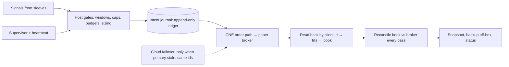

# How to build an agentic trade desk — a guide for LLM agents

> **Audience:** an AI agent (or a human) that has been pointed at this folder and asked to *build, extend, or operate* an autonomous **paper-trading** desk.
> **Not financial advice. Paper / simulated trading only. Start on paper; stay on paper.**

This guide distills the failures, repairs and design rules from several real desks built by humans and AI agents. It is generic: no particular strategy is endorsed, no account or infrastructure is described. The **pitfalls** are the main asset — each one happened.

## Reading order

| # | document | read when |
|---|---|---|
| — | [`AGENTS.md`](AGENTS.md) | **first**: your standing rules and hard limits |
| 00 | [Context and principles](docs/00_context_and_principles.md) | before anything |
| 01 | [Requirements](docs/01_requirements.md) | before choosing tools/accounts |
| 02 | [Architecture](docs/02_architecture.md) | before writing code |
| 03 | [Setup, step by step](docs/03_setup_step_by_step.md) | while building (follow in order) |
| 04 | [Strategy sleeves](docs/04_strategy_sleeves.md) | before adding any strategy |
| 05 | [Execution and order safety](docs/05_execution_and_order_safety.md) | **before touching orders** |
| 06 | [State, ledger, reconciliation](docs/06_state_reconciliation.md) | **before touching state** |
| 07 | [Reliability and operations](docs/07_reliability_ops.md) | before running unattended |
| 08 | [Research and validation](docs/08_research_and_validation.md) | before trusting any result |
| 09 | [Multi-agent coordination](docs/09_multi_agent_coordination.md) | when more than one agent/human works on it |
| 10 | [Pitfalls catalog (130)](docs/10_pitfalls_catalog.md) | when designing a component, and when anything breaks |
| 11 | [Checklists](docs/11_checklists.md) | daily ops, incidents, changes |
| 12 | [Security](docs/12_security.md) | before the first key and the first push |
| 13 | [Worked example](docs/13_worked_example.md) | to see the invariants run |
| 14 | [Timeline and lessons](docs/14_timeline_and_lessons.md) | for the story behind the rules |
| 15 | [Prompts and routines](docs/15_agent_prompts_and_routines.md) | when scheduling agent wake-ups and roles |
| 16 | [FAQ and decision guide](docs/16_faq.md) | quick answers |
| 17 | [Reconciliation with the companion guide](docs/17_companion_guide_reconciliation.md) | to merge this kit with [`docs/AGENTIC_TRADE_DESK_BUILD_GUIDE.md`](../docs/AGENTIC_TRADE_DESK_BUILD_GUIDE.md) |

> **Companion guide:** a shorter architectural guide lives at [`../docs/AGENTIC_TRADE_DESK_BUILD_GUIDE.md`](../docs/AGENTIC_TRADE_DESK_BUILD_GUIDE.md). Read both; [doc 17](docs/17_companion_guide_reconciliation.md) maps them. Two differences to decide consciously: this kit uses *no automatic monitor-triggered halts* (a human-invoked halt that only blocks new entries is fine) and treats live trading as out of scope.

Code: [`skeleton/`](skeleton/) (generic Python, stdlib only, tests included) · Templates: [`templates/`](templates/).

## The 60-second version



1. **Single order path**; everything else simulates. Tests can never send orders.
2. **Deterministic ids from data**, persisted *before* the order is sent; a timeout is *unknown*, not refused.
3. **Append-only ledger**; the book is a fold of it; reconcile with the broker every pass; **never trade to fix a mismatch**.
4. **Lock + atomic write + add-only merge** for state; **hard deadlines** and **monotonic** time everywhere.
5. **Alert, don't halt.** Missing data → skip and alert. Only per-trade risk exits stop positions.
6. **Assume the machine is paused, wiped or killed**: supervisor with resume-awareness, off-box backups, restore drills, a cloud standby.
7. **Evidence before green**; every bug → log row + a test that fails on the old code.

## Try it (30 seconds)

```bash
cd agentic-trade-desk/skeleton
python3 -m unittest discover -s tests -v     # 19 invariant tests
python3 examples/run_example.py              # toy desk; shows restart-safety
```

## How an LLM should use this repository

1. Read `AGENTS.md`, then `docs/00`. Write down (in your own words, in your working repo) the five-line SCOPE of the task you were given.
2. Follow `docs/03` step by step. After each step capture the **proof** it asks for.
3. When you design or change a component, read its document and the matching pitfalls (`docs/10`), and add the **guard tests**.
4. Use `templates/` for receipts, sleeve cards, bug-log rows and the runbook.
5. Operate with `docs/11`. Stay inside the perimeter in `AGENTS.md`. Ask a human for the things on its hard-limit list, and for nothing else.

## Scope and honesty

* This is *engineering* guidance for building automation around paper trading. It makes **no claim** that any strategy is profitable; the research chapter explains why most apparent edges are not.
* Examples cite public vendor classes (a paper-trading brokerage API, free market-data endpoints, a serverless platform, a git host) only as illustrations. Substitute your own.
* Real-money trading is intentionally **not covered** and **not implemented**. If a human wants it, that is a separate project requiring independent legal, regulatory, risk and security review.

## License / use
Reference material and example code for education. Provided as is, no warranty. Adapt freely; keep the risk notes.
