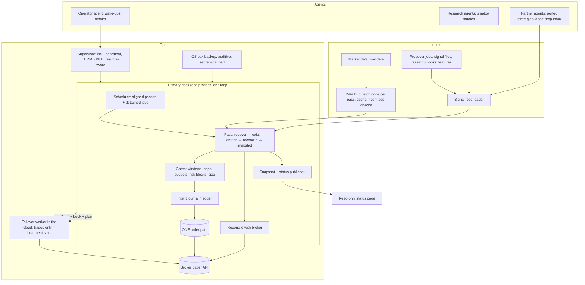
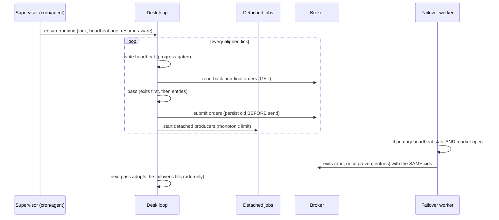

# 02 — Architecture

## 2.1 Component map



## 2.2 Components in detail

### 2.2.1 Data hub
*Fetches each series once per pass and fans it out.* Without this, many sleeves can duplicate requests for the same bars, wasting quota and delaying the pass. Properties:
* single fetch per (symbol, timeframe, pass); bounded concurrency (e.g. ≤ 4 in flight) with one writer;
* **Missing(reason) ≠ negative evidence.** A missing bar yields "unknown", which a sleeve must treat as "do nothing and report";
* bar cache **keyed by file mtime/version**, one frame per symbol — an early version cached for the life of the process (new data invisible after the nightly refresh) and a later "fix" kept every version (memory grew without bound). Replace, don't accumulate;
* a fallback is eligible only when its source, contract, timestamp, adjustment basis, and freshness satisfy the strategy's written policy. A previous-session value may support research, but is not silently promoted to an executable current price.

### 2.2.2 Signal feed loader
Strategy research usually produces *files* (fires with dates, validity windows, reference prices). The loader:
* reads them read-only, validates schema and age, and reports staleness (a producer file frozen for days once silently disabled a lane: add an age check and an alert);
* remembers every fire it has *seen* until decided (otherwise a fire that is only visible for N days vanishes on its last valid day — an off-by-one that cost real entries);
* never lets one malformed row abort the pass.

### 2.2.3 Sleeve contract
A sleeve exposes two methods and declares its config. See `04` §4.2. Anything else (sizing, caps, order sending) is the *host's* job, so the rules cannot be bypassed by a sleeve.

### 2.2.4 Gates
A pipeline of pure functions evaluated in a fixed order. Each returns `allow | wait | skip(reason)`:
1. entry **window** (time of day / days after signal),
2. **market-condition** gate (research rule, e.g. "only buy when the index and the stock are both down today"),
3. **price cap** (e.g. never pay more than 1.02× the signal close),
4. **liquidity / size** class,
5. **lane cap + budget**,
6. **cash / buying power** check ("place what fits" rather than nothing),
7. **concentration** *alert* (do not block; make it visible).
Distinguish `wait` (try again later in the window; does *not* burn the session's decision) from `skip` (final). An input that is unknown ⇒ `wait`, not `skip`.

### 2.2.5 Order path
One module, one process. Persists the intent, sends, reads back, applies fills. See `05`.

### 2.2.6 Ledger & state
SQLite WAL ledger (append-only, hash chain) + a JSON state file for the book, both written under a file lock with atomic replace. See `06`.

### 2.2.7 Scheduler
* **Aligned passes** (e.g. 20 s after each 5-minute bar closes) instead of "every 300 s from an arbitrary start" — drift moved passes outside critical windows;
* due passes run **before** same-tick side jobs;
* long producers (data refresh, research jobs) run **detached** with monotonic limits and their exit code is read back and alerted;
* a **catch-up** rule after a pause: run the missed pass once at the next boundary, don't replay every slot.

### 2.2.8 Supervisor, backup, failover
`07`.

### 2.2.9 Reporting
A read-only snapshot (JSON) → a status page. The snapshot must contain the *reasons* for non-actions. A reporting layer can lie by accident; see the P&L-reconciliation and wording pitfalls in `10`.

## 2.3 Process model



## 2.4 Data and control flow of one pass


Exits before entries because an exit frees cash and a slot and because time-critical risk exits must not queue behind a slow entry path. When more candidates than free slots exist, order them by a *declared* ranking, not by dictionary order.

## 2.5 Directory layout (recommended)

```
desk/
  AGENTS.md                # operating rules for agents (copy of ../AGENTS.md, edited)
  config/                  # sleeves.json, lane_budgets.json, desk.json (no secrets)
  engine/                  # data hub, gates, order path, ledger, reconcile, scheduler
  sleeves/<family>/        # one file per sleeve + a card (docs) per sleeve
  vendor/                  # external strategy code, byte-for-byte + manifest.sha256
  tools/                   # supervisor, backup, restore, warmers, audit, secret scan
  tests/                   # unit + regress + fake broker + fixtures
  evidence/                # fix notes, audits, undo copies, restore drills (additive)
  docs/                    # RUNBOOK, BUG_LOG, INVENTORY, per-sleeve cards
  state/                   # runtime only; gitignored (ledger, book, heartbeat, logs)
```

`state/` is **never** committed; a scrubbed copy goes to the off-box backup. `evidence/` is committed and append-only.

## 2.6 Design decisions that were expensive to learn

| decision | do | don't |
|---|---|---|
| process count | one loop, detached jobs for slow work | many cooperating loops with their own order paths |
| clocks | monotonic for timeouts; tz database for sessions | wall-clock deltas; fixed UTC offsets |
| state | ledger + fold, atomic file replace, locked RMW | in-place edits; unlocked JSON |
| config | hot-reloaded each pass; unknown keys alert | restart-only config; exceptions on unknown job names |
| strategies | thin sleeve interface; host owns safety | each sleeve sending its own orders |
| failures | isolate per sleeve and per fire; alert | one try/except around the whole pass or no try at all |
| tests | fake broker + frozen fixtures; real-path smoke | tests that read live data or can send live orders |
| naming | stable ids per sleeve/lane/fire | "latest", "final", labels as identity |
