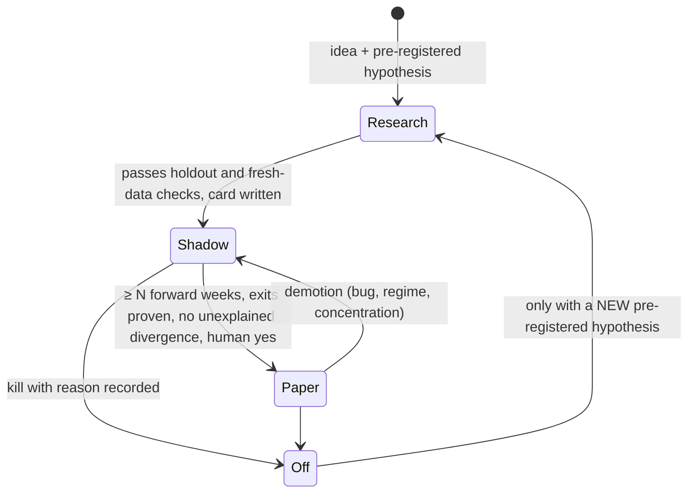

# 04 — Strategy sleeves: onboarding, lanes, sizing, caps, promotion

## 4.1 What a sleeve is, and what it is not

A **sleeve** is one strategy with its own rules, budget and slots. The desk hosts sleeves; sleeves do **not** talk to the broker. The host supplies bars, positions, cash and clock; the sleeve returns *intents*; the host applies gates, caps, sizing and sends orders through the single order path.

```python
# Generic sleeve contract (skeleton)
class Sleeve:
    name: str                      # stable id, never reused
    kind: str                      # "1d" | "1w" | "1h" | "intraday" ...
    def entries(self, ctx) -> list[dict]:
        """Return entry intents: {sleeve, symbol, side, bar_ts, kind:'entry', qty?, limit?, ref_price?, deadline?}
        bar_ts = timestamp of the newest DATA bar the decision used (never now())."""
    def exits(self, ctx) -> list[dict]:
        """Return exit intents for open lots. Must terminate: every sleeve needs a time exit or a signal exit
        that can actually fire (see 4.9)."""
```

`ctx` carries: bars accessor (point-in-time), positions of *this* sleeve, cash/budget, a pinned `session_date`, a `mark(symbol)` accessor that returns `None` when unknown.

## 4.2 The sleeve card (documentation as a gate)

No sleeve is installed without a card (`docs/cards/<sleeve>.md`) containing:

| field | content |
|---|---|
| id, family, origin | where the rule came from (own research / public recipe / partner agent / vendored library) with a version or hash |
| universe | what it may trade; exclusions |
| bars / timing | timeframe, when the signal is evaluated, when the order may be sent, **what price the fill is modelled at** |
| entry rule | exact, in words and as the code reads it (cite the line) |
| exit rules | time exit (counted from *fill*, not from the planned bar), signal exit, target, trail, per-trade stop |
| sizing | dollars per slot, size classes, caps (% of average dollar volume if you use one) |
| lane | `max_slots`, `budget_usd`, window, concentration limits |
| data prerequisites | feeds, freshness limits, failure behaviour |
| status | `research` / `shadow` / `paper` / `blocked(reason)` / `off(reason)` |
| evidence | forward results to date, link to ledger rows; **backtest numbers belong in research, not on the card as a promise** |

A sleeve whose rule you cannot state without hedging is not ready.

## 4.3 Lifecycle: research → shadow → paper



* **Shadow** means: runs in the real loop on real data, fills are simulated at the observed mark, and everything is logged exactly as if it traded. It is the cheapest honest forward test.
* **Paper** means: real orders on the paper account via the one order path, capped small (e.g. one-to-a-few slots of a modest size) until the shadow-vs-paper behaviour matches.
* Promotion is a **reviewed registry change** (a commit), not a flag flipped at runtime.
* Keep *kill* decisions in a ledger with the reason. An idea killed by one failed gate should not be revived by one lucky result; require a *new* pre-registered hypothesis and the same three tests (train, holdout, fresh).

## 4.4 Onboarding pipeline for a batch of sleeves

When many sleeves arrive (from a partner agent, a library, a research lab):

1. **Inventory first.** One row per sleeve with a stable id and idempotency key. Reconcile against what is already installed. Count *distinct* ones; configs that overlap catalog rows must not be summed as separate sleeves.
2. **Source identity.** Pin each source by repository + commit + content hash. "latest" is not provenance. Vendor external code **byte-for-byte** with a manifest (`vendor/MANIFEST.sha256`). If it is too slow or needs a fix, add a shim *outside* the vendor directory and prove outputs are identical on a corpus (a speed shim for an O(n²) routine was accepted only after 284/284 identical outputs).
3. **Fidelity check against the origin.** Port rules exactly, then diff behaviour on random and historical inputs (parity test). A ported "buy block" was inverted — the original blocked on a red day and the port blocked on every *other* day — and 20 sleeves would have bought on the wrong days. A 4000-random-case parity test is what found it.
4. **Install shadow-only** first. Sleeves that need data you do not have are installed as `blocked(reason)`, not faked.
5. **Exit audit.** Mechanically verify every sleeve's exit routes terminate (see 4.9).
6. **Load/rehearsal.** Run a dry rehearsal at realistic count (hundreds of sleeves) and measure first-pass time, steady-pass time, memory, and replay equality.
7. **Record.** Catalog row, card, tests, evidence file. Add to the inventory *count* only what actually runs. **Do not pad the number.** A headline count of "N sleeves" that includes blocked, merged and replaced rows misleads everyone; publish `running`, `blocked`, `off`, `merged` separately.

### 4.4.1 Duplicate and overlapping sleeves
Merge, don't duplicate. A source row that matches an installed sleeve is recorded as `merged_into` and runs exit-only (so existing lots still close) rather than entering twice. Overlapping *experiments* (same idea, two parameterizations) are allowed but documented as overlapping, so a human does not read them as independent evidence.

## 4.5 Lanes, slots and caps

A lane has:

* `max_slots` — concurrent positions **plus queued entries**,
* `budget_usd` — dollars it may commit,
* `slot_usd` — dollars per slot (budget / slots, in steps like $1,000),
* an **entry window**,
* a **size class** (e.g. `normal`, `log_only` = record the signal but do not trade it).

Rules (each a real failure; code in `skeleton/deskkit/caps.py`):

1. **Occupancy = open + queued.** A queued entry that has an order live must count.
2. **A slot is consumed only by an order.** Looking at a fire, finding it out of window, or waiting must not take a slot. (A lane once blocked valid in-window fires behind three out-of-window fires.)
3. **Refusal releases the slot.**
4. **Queued entries have deadlines.** Past the deadline or after a final skip they end (`entry_expired`) and release the slot. Otherwise they are re-adopted every pass forever.
5. **A pending entry counts against budget at its limit price** (not $0 until filled), or a lane can over-commit inside one session.
6. **Caps are config, changes are decisions.** Don't "optimize" caps silently. A temporary rescale to fit a smaller capacity was later *undone* when evidence showed lanes were starved and valid signals were blocked; the undo was possible because the pre-change file was kept.
7. **"Blocked by a full lane" is a normal, countable outcome.** Report it as such (`blocked_fires`, per lane per day) so nobody mistakes it for a bug — or hides a bug behind it. Audit it: count open + queued vs `max_slots` and confirm caps equal the last intended values.

### 4.5.1 Ordering when slots bind
If a lane has more candidates than free slots, order by a declared rank (e.g. conviction tier, then sleeve score, then symbol). Never rely on dict order.

### 4.5.2 Concentration visibility
Many sleeves can buy the same name in the same pass. Do **not** silently shrink sizes. Emit a **concentration alert** when ≥ 3 books buy one symbol or the combined dollars exceed a threshold in one pass. Visibility, not a block.

## 4.6 Sizing

* **Dollars per slot**, whole shares that fit; with no reservation price, size at the limit actually committed (a 1% price buffer made every entry one share short until fixed).
* **Never use a liquidity rule you did not research.** A generic "no more than 1% of average dollar volume" cap and "unknown volume → no order" were removed because they came from a template, not from the strategy's research, and silently excluded small names the research was *about*. If you use such caps, make them **alerts** unless the sleeve's own research requires them. (A sizing study found the real limit was *capital*, not liquidity.)
* Short cash: place what fits (≥ 1 share), alert "placed what fits"; place nothing only if one share does not fit.
* Round limit prices to the legal tick (≥ $1 → 2 dp, < $1 → 4 dp), buys down, sells up, and **never above a binding cap after rounding**.

## 4.7 Budget vs capacity

```text
sum(lane budgets)  vs  overnight capacity of the account
```
* Compute it every build; **alert** if the sum exceeds capacity; label it "by design" only if someone decided so.
* A test account can legitimately have budgets that exceed capacity (not all lanes fill the same day) — but then heavy days will hit "insufficient buying power" rejections. Handle that rejection as `refused: insufficient_bp` with a clear reason and do **not** retry in a loop.
* Cash is not reserved for lanes unless you implement reservation. State which you chose.

## 4.8 Common entry/exit rule patterns and their traps

| pattern | trap |
|---|---|
| "buy on the first red-market day within 5 days after the signal" | the window's last day: producers drop fires older than N days, so on day 5 the fire is gone — remember seen fires until decided |
| "buy near the close" | a decision window of 30 minutes means a 15-minute-late pass loses the day; align passes, cap producers, guarantee a pass inside the window |
| "fill at next open" | model the fill at the open, not the signal bar's close; a sleeve filled at the *previous close* because the generic mark was "last closed bar" |
| "signal on the last closed weekly bar" | for a stop, a stale weekly bar can be a week old; judge stops on the freshest closed *daily* bar |
| "limit at 1.02× signal close" | rounding can lift a buy above the cap by half a cent; floor to the cent when binding |
| "hold N bars" | count from the **fill**, not from the planned entry bar, if fills can land days later |
| "trail the rest after the target" | volatility input (ATR) may never be set on new lots; trail then sells on the first pass — backfill ATR, or hold when unknown |
| "market-wide condition" using a vol index | feed may be delayed 15 min; a freshness limit shorter than the delay makes the condition unknown forever |
| "exit when signal flips" | the exit function needs inputs (next trading day, running peak). If the host doesn't pass them the exit can never fire (P-40) |
| options / short / crypto in a stock book | model options in contracts ×100 with premium and intrinsic expiry; shorts cover with a *buy*; crypto runs 24/7; keep non-supported instruments shadow-only |

## 4.9 Exit audit (mechanical)

For every sleeve assert **at least one exit route that can fire given the inputs the host really provides**, and that the time exit counts from the fill. Generate a table: `sleeve | entry → exit routes | terminates? | stop`. A sleeve that reports `terminates: no` is a bug until proven otherwise.

### 4.9.1 Per-trade risk exits (the only automatic hard stops)
* A **standing disaster stop** (e.g. −15% from entry) on every lot whose research plan has no stop, *recorded on the lot* so it is visible and so it survives restarts. Exempt lots only by explicit id list with a recorded decision.
* The stop must be evaluated **in the same pass** it becomes true — if the code that learns "the broker refused the stop" runs after exits, the lot sells one pass late.
* Place **broker-side stop orders** for open lots (good-til-cancelled) so a sleeping machine does not leave positions unprotected; handle: one stop per lot, replace on qty change, a refusal (price already through) falls back to the desk stop, a foreign stop for the symbol satisfies the requirement, and **any sell must first cancel and confirm cancellation of overlapping stops** (brokers reject overlapping sells).
* Gapped through the stop → the stop fills at the market; record that honestly ("gapped through the stop").

## 4.10 Fill-price semantics

Write down, per sleeve, *which price the fill is modelled at* and test it. Typical errors: signal-bar close vs next open; stale daily close during the session; using the daily close when a fresher 1-minute price exists (choose the freshest timeframe by timestamp). Past rows are **not rewritten** when you correct this; record corrections as additive notes.

## 4.11 Sleeve count honesty

Report: `running`, `shadow_only`, `blocked` (with reasons), `merged/replaced` (exit-only), `off`. Never add a configuration row and a catalog row for the same strategy. Never count a placeholder. If an inventory says 395 and only 350 run, the report says 350 and shows the 45.
