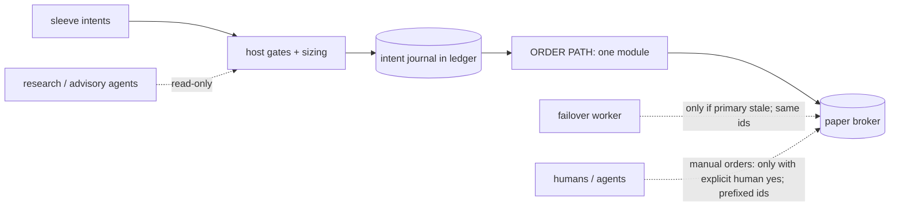
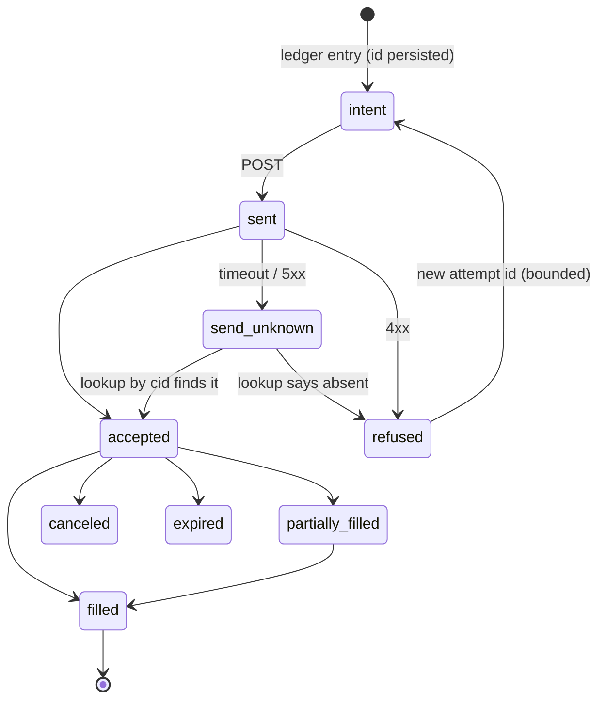

# 05 — Execution and order safety

> This is the highest-stakes document. Most severe failures in desk history were here.

## 5.1 The single order path



Rules:
1. Exactly one process contains the code that POSTs orders. Other loops (research, simulations, dashboards) use `ShadowBroker` or no broker.
2. The mode is explicit configuration: `shadow` (default) or `paper` + an **allow-list of account ids**. Live money is not implemented.
3. **Tests can never send orders.** Every test pass runs with `mode="shadow"` or a fake broker; a regression check asserts it. (When the config flipped to paper, tests that called `run_pass` without a mode would have sent real paper orders.)
4. Manual orders by a human or agent use a distinct id prefix (`manual-…`) and are logged out-of-band into the ledger so reconciliation and backups include them; an audit that compares broker orders with the book must understand that prefix.
5. A retired desk is **tombstoned**: its entry point raises `SystemExit` when run as `__main__`, its launchers are non-executable or point at the new desk, and a supervisor cannot resurrect it (a supervisor once restarted every retired scheduler 2 minutes after the shutdown order).

## 5.2 Deterministic client order ids

```python
signal_key = f"{sleeve}|{symbol}|{newest_data_bar_ts}|{kind}|{side}"
cid        = f"{prefix}-{sha256(signal_key)[:16]}-{leg}-{attempt}"   # ≤ 48 chars
```
* `attempt 0` is the first try. A **refused** order (HTTP 4xx other than 429) may be retried with `attempt+1` on later passes (bounded: e.g. 3 entry tries; exits retry every pass until filled).
* A **transport error / timeout / 5xx** is **`send_unknown`**: the order may exist. Do not mint a new id. Next pass: GET by cid. Found → apply; absent → *now* it is a refusal → retry with `attempt+1`.
* Exit ids include the position's entry cid, so a second round trip in the same sleeve/symbol can still exit.
* If your strategy library stamps ids with the pass clock, **re-key them from the data** in the host and keep the library untouched. Include a transitional guard: "same sleeve + symbol + reason already entered earlier today under a stamp key ⇒ treat as taken".
* Keep a **daily file of terminal-state order ids** (fsynced). Before any POST, refuse any id that already appears there (filled/cancelled/rejected/expired): a resend under a finished id must be impossible even if the lookup fails.

## 5.3 Order lifecycle



**Final states are only `filled, canceled, expired, rejected, replaced`.** `accepted`, `new`, `pending_new`, `partially_filled`, `done_for_day`, `stopped`, `suspended`, `calculated` are **working** states: keep reading them back. Marking `done_for_day` as final lost fills; marking an immediate `accepted` as a void would have cancelled valid entries.

### Partial fills
* Book the filled quantity; re-arm the remainder (for exits) or let the order keep working (for entries).
* A cancelled/expired order **with a partial fill** books the filled part.
* If an exit sold the shares of a partially filled entry and the working entry order fills *afterwards*, the position must **reopen** and the next due pass sells the remainder. (A closed position with shares at the broker was never sold and alerted forever.)

## 5.4 Persist before send (crash safety)

```text
1. decide intent              -> ledger: intent / entry_sent (cid)       [durable, fsync]
2. state saved with the cid   -> JSON state (under lock)                 [atomic replace]
3. POST to broker
4. read response / lookup     -> ledger: order_accepted | refused | send_unknown
5. fills                      -> ledger: fill (unique per cid + cumulative-fill delta)
6. pass_end                   -> ledger: pass_end with book hash
```
At startup verify `book hash == last pass_end hash` (alert on gap). A test kills the process between 2 and 3 (a `SuicideBroker` that raises `SystemExit` inside `submit`) and asserts the restart finds one order, not two, not zero.

## 5.5 Order construction

| item | rule |
|---|---|
| order type | limit for entries (with cap), limit/market for exits per sleeve spec; avoid auction-only types on paper brokers (opening/closing auction orders expired unfilled in 6 of 8 attempts on one paper broker; keep them off or prove them) |
| time in force | `day` for entries; `gtc` for protective stops |
| price | tick-rounded, cap-respecting; buys floor, sells ceil; **sub-penny rejections** (broker error 422) are a bug |
| quantity | whole shares that fit the slot; shorts cover with a buy; options in contracts |
| rate limits | on 429 honor `Retry-After`/reset header (≤ 10 s in-pass); GET retry 3× (1/2/4 s) on network/429/5xx; 4xx fail fast; **POST never blind-retried** |
| latency | record `order_lat_ms` per pass (first, max) so regressions show |
| session | equities only 09:30–16:00 exchange time on trading days; crypto 24/7 |

### 5.5.1 Reference quote chain (price used for the cap and sizing)
In order: fresh last trade (≤ 10 min) → fresh *tight* mid (≤ 10 min, spread ≤ 2%) → today's session price from a secondary provider → today's last trade even if older. **Every fallback raises an alert**; if nothing exists the decision is `wait` (entries) or `wait + alert` (exits) — never a guess, never a void.

## 5.6 Exits

* **Exits first** in every pass.
* An exit that is due but has no observable mark **waits and alerts**; it must not send an order that is certain to be voided.
* A refused or voided exit is **re-sent each pass under a new attempt id** until it fills. (Reusing the id could drive an illegal `exiting → flat` transition; the FSM makes that loud.)
* Time exits: counted from fill; if the mark window is narrow (e.g. a 15-minute feed refreshed only for a few hours), a due exit must **refresh the feed itself** and the window must cover the whole session. A time exit executed late is **labelled** `LATE exit: due … executed …` in the ledger.
* Signal exits need their inputs. Pass `next_trading_day` and the running `peak since fill`; test that an exit *can* fire with the host's inputs.
* Broker-side protective stops: see `04` §4.9.1. One more trap: a failover must **re-place** stops it cancelled (same price, GTC, with a *foreign-stop* id prefix) for `held − sold`, otherwise selling one lot leaves the rest of the symbol unprotected.

## 5.7 Entries in a decision window

* The pass must run **inside the window**: aligned passes, a **guaranteed pass** (if none has run in the last N minutes and the window is open, run one), producers capped so they finish ≥ 5 minutes before the cut, and due passes run **before** same-tick publish/backup jobs.
* A decision that lacked an input → `wait` and do **not** consume the session's one decision.
* A broker refusal at the first slot **clears the session mark**, so the next pass in the window retries (with `attempt+1`).
* A fire on its **last valid day** must still be decidable (see off-by-one in `04` §4.8).

## 5.8 Failover/standby order rules

1. Trades only if **primary heartbeat stale ≥ N minutes** and market open.
2. Uses the **same cid scheme** (so even a simultaneous run cannot double an order) and the same stop-id prefix.
3. Skips any symbol with a live non-stop sell order.
4. Exits first; entries only after a clean dry day and a human yes; entries come from a **plan exported by the primary** and dated for the session; refuse a plan with the wrong date.
5. The primary must **adopt** the standby's fills on its next pass (`04`, `06`), identifying them by id prefix; sells adopted as that lot's exit; buys imported from the broker if the standby's own book write failed.
6. If the platform's write quota is nearly exhausted or a write probe fails, the standby **stands down** (cannot record ⇒ must not act).

## 5.9 The test double zoo (build these early)

| double | behaviour | proves |
|---|---|---|
| `ShadowBroker` | fills at mark; idempotent by cid | default safe mode |
| `FakeBroker` | in-memory order book with working/final states, partial fills, 429s | lifecycle |
| `FlakyBroker` | accepts the order then raises transport error | send_unknown → lookup, no duplicate |
| `SuicideBroker` | raises `SystemExit` after accepting | crash between send and save |
| `RefusingBroker` | 4xx on first N attempts | bounded retry, slot release |
| `SlowBroker` | sleeps past the deadline | pass deadline, alert |
| `Frozen clock` | fixed `now` | window logic, DST, after-midnight |

Test the **real path** with the fake broker at least once per change: run_pass with real inputs, a fake broker, verify the order set. Unit tests of components cannot prove an end-to-end claim.

## 5.10 Pre-trade safety checklist (each pass)
- [ ] mode is `shadow` or `paper`; account id in allow-list; key file present (presence only)
- [ ] clock/session pinned; calendar says open (for equities)
- [ ] ledger writable, chain verifies; book hash == last `pass_end`
- [ ] recovered every non-final order by cid
- [ ] exits evaluated before entries
- [ ] every order has a cid persisted before send; no cid present in the terminal-orders file
- [ ] caps/budget evaluated with open + queued; refusal releases slot
- [ ] reconcile run after sync; mismatch → alert, not trade

## 5.11 Things never to do
* Never send an order from a test, a notebook, a "quick check" script, or an agent's ad-hoc shell without a human's explicit yes and a `manual-` id.
* Never "fix" a book/broker mismatch by trading.
* Never re-use an id after a timeout.
* Never cancel *all* stops for a symbol to sell one lot without re-placing the rest.
* Never loosen a safety check to make a test or a pass go faster (the speed-up must keep identity, freshness, completeness and safety).
