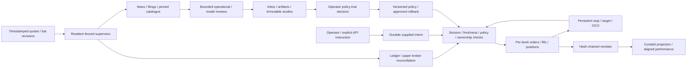

# Aster Desk architecture

Aster implements autonomous operations and supplied-instruction paper execution. The strategy registry is empty. References: **Femto/Midna, Cursor and GrokBot**, with pinned evidence in companion manifests.

## Runtime and authority

Research and inbox content are evidence. Model tools read facts; they cannot submit instructions, fund books or write policies. Proposals expose a small operational parameter allowlist and require approval plus explicit application. Automatic rollback applies only to the approved trial/guard, with policy-hash comparison preserving later operator decisions.

Six local roles audit data, reconcile accounts, inspect risk, report execution state, coordinate and archive. Optional model roles independently review risk, desk context and journals. Each handoff/tool/model call leaves a receipt. Scheduled model briefs use a durable queue and bounded tool budget. Model output is never parsed as an order.

## Persistent components

| Module | Responsibility |
| --- | --- |
| `store.py` | SQLite transactions, manual ledger, quotes, tasks/steps/leases, hash-chained events |
| `trading.py` | Autonomous books, capital, intents, reserves, fills, signed positions, protection, policy history, reconciliation |
| `providers.py` | Yahoo/Alpaca data, paper-only broker transport, status, NYSE calendar, immutable revisions |
| `autonomy.py` | Resident supervisor, file/SQL fencing, heartbeat, schedules/jobs/retries, execution and verification |
| `worker.py`, `reasoning.py` | Durable workflows and optional bounded read-only model/tool rounds |
| `research.py`, `lab.py` | Source receipts, inbox/cursors, alerts/incidents, studies, evidence, policy trials/rollback |
| `analytics.py` | Closed round trips, fees, cashflow-aware returns, aligned benchmarks, public projection |
| `notifications.py` | Durable outbox, optional external channels, uncertain-send resolution |
| `strategy_contract.py` | Future candidate/evidence interface; zero installed strategies |

Tables share a WAL-enabled SQLite database; autonomous `p_` books remain independent of the manual ledger. External account bindings are separate. Revisions retain provider time and observation time: later corrections do not silently rewrite earlier evidence. UTC timestamps coexist with actual New York exchange sessions, DST, holidays and early closes.

## Execution and recovery

Instructions have durable idempotency identities. Local fills use fresh observed quotes and explicitly configured costs/partial-fill limits; they make no exchange liquidity claim. Market/limit/stop/stop-limit orders persist. Day/GTC/open/close instructions obey session and expiry rules. Stops/targets create persistent OCO children covering newly opened exposure. Reducing exits remain available during a halt.

Broker submission persists the client identity before transport. Retries query that identity before resending. Acceptance differs from fill confirmation; cumulative fill deltas commit exactly once. Reconciliation reads account, positions and orders before committing truth. Failed reads preserve prior state and block the affected account. Unknown external positions remain locked until an operator decision. Native broker brackets that would cover/flip existing exposure are rejected.

Reservations reflect outstanding liabilities and OCO ownership. Cancellation requests survive reconciliation failures. Exits and cancellation are prioritized; other waiting instructions rotate fairly. Wall time is rechecked before financial effects, including after broker lookup. Reported broker fees are unavailable from the current order adapter, so it records no invented fee and withholds total-return comparability.

Supervisor/task leases exclude duplicate workers. Jobs retry with bounded backoff and stamp success only after completion. Expired windows leave missed/skipped receipts rather than late execution. Journal verification gates financial processing if its chain fails. Additive backups use SQLite's consistent backup API and integrity checks without wiping evidence. Deployment samples restart the process; the independent monitor must be installed separately to detect host loss.

Policy application/restoration records durable intent before changing the versioned policy. Exact policy-history actors recover interrupted effects. An interrupted rollback never replays over a later operator edit. Automatic drawdown guards require complete, fresh marks.

## Research and future edge evaluation

Collectors retain watchlist news and configured SEC filing receipts. Catalogue search returns repository paths and exact blob/ref/commit pins. Agent reviews consume facts, book state, cached bars and peer messages. This is a working evidence layer, not a complete predictive or fundamental research engine.

Studies preserve hypotheses, methods, datasets, metrics, controls, acceptance criteria, sample targets and source pins before results. Results/stage changes append; failed findings remain. Artifacts have content hashes. Tape-linked execution reviews catch up through a durable fill cursor rather than only the visible last page.

The future strategy contract records source/data identity, pre-registration, train/holdout boundaries, costs and benchmarks. Future evaluators must enforce point-in-time universes, corporate actions, look-ahead controls, independent holdouts, multiple-testing accounting and forward-paper evidence before promotion. Those evaluators are not installed. Historical strategies and calibration constants were not imported.

## Performance and projections

Deposits are separate from gains. Local return chains use pre/post-funding valuations. Partial exits do not become closed-trade wins; flips split exposure and fees. Benchmark comparisons require two common clean end-of-day book and QQQ/SPY samples, a common interval and stated vendor-adjusted/raw-close scope. Missing/stale marks withhold comparison. Broker returns are withheld when external cashflow history is unknown.

Public projection excludes internal instructions/protected policies. Export preserves evidence but omits environment credentials, browser subscription secrets and signed media URLs. External notifications require enabling. Timeout/ambiguous sends become unknown and require resolution.

## Present limits

The runtime supports equity paper books. Options/multi-leg orders, streaming ticks/order feeds, full corporate-action processing, entitlement management, strategy evaluation/promotion and investment selection remain extensions. Public data may be delayed/unavailable; failures and freshness stay visible. Source review/tests establish mechanics, not deployed broker availability or profitability.

Registered research DAGs execute one bounded read-only node per pass: source collection, bar history, catalogue lookup and factual dependency summary. Plans are immutable; run/node leases, dependency states, cancellation fences, retry attempts and hashed receipts persist. Failed prerequisites block descendants. Disabling a plan stops future scheduling; explicit cancellation fences an active run. No arbitrary code or financial tool is registered. History manifests/page cursors bind to immutable revisions; Alpaca continuation creates a new revision without rewriting earlier pages.
