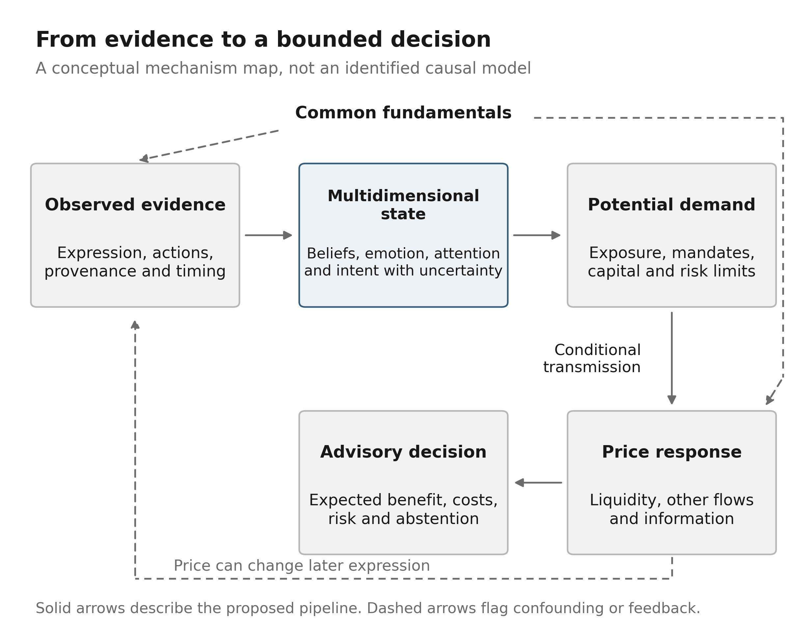
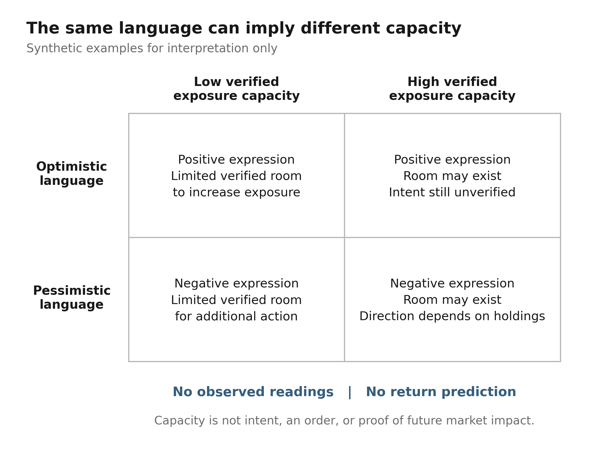
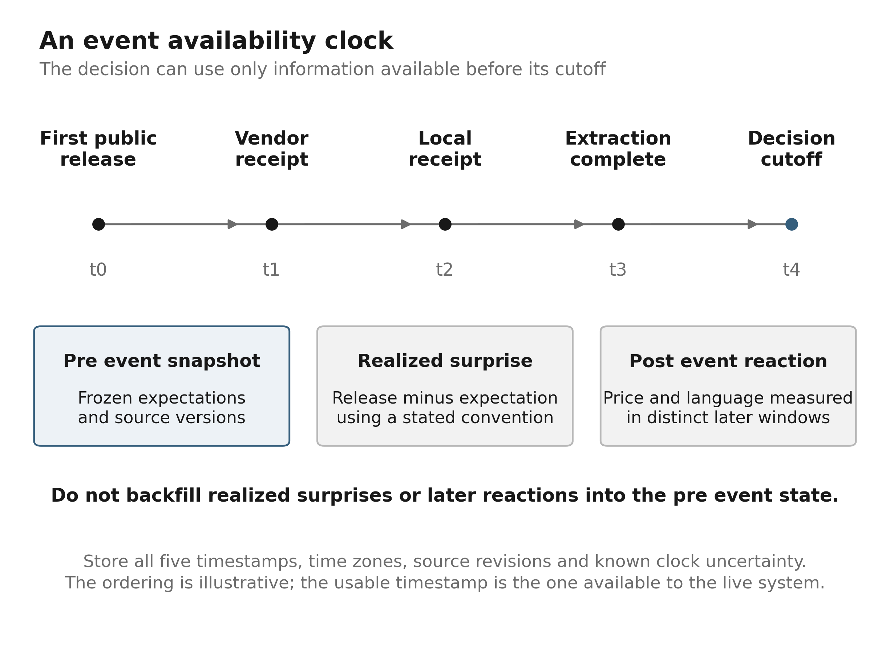
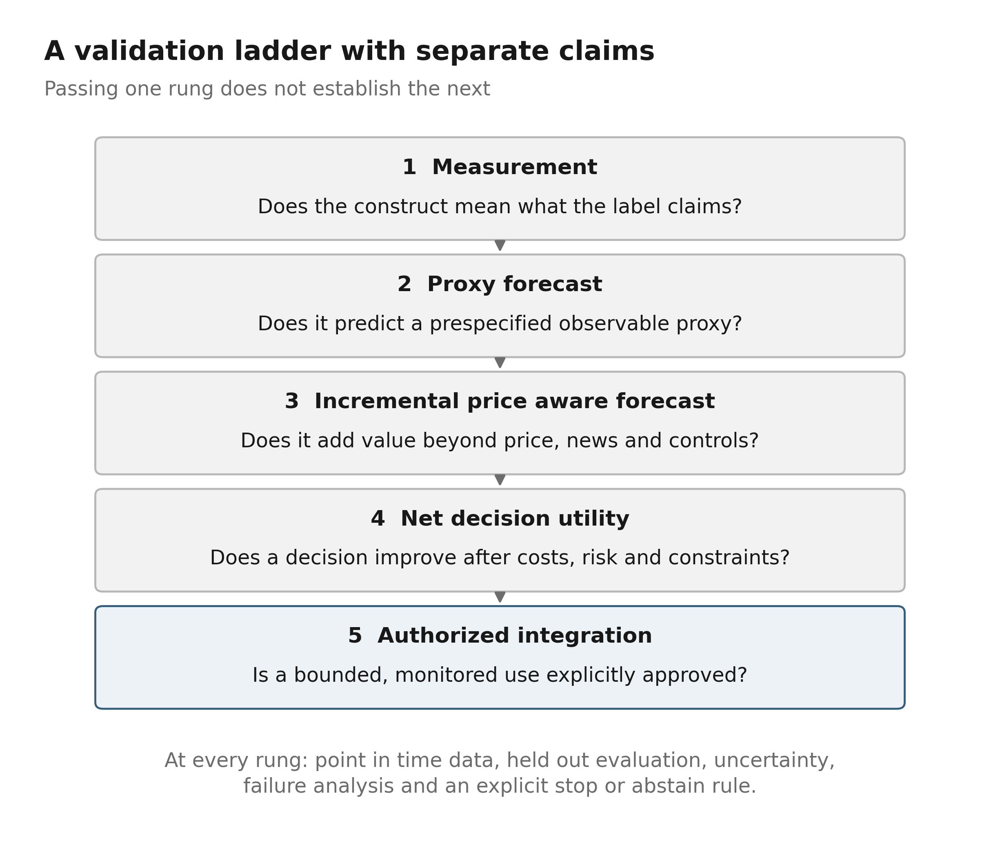

# Psychology Engine Research and System Design

A framework for measuring market beliefs and testing their decision value

30 October 2026

## Executive findings and build decision

**Build a psychology research and advisory engine, not a universal sentiment score and not a mind reader.** Its useful task is to estimate how specified populations interpret information, how those interpretations may change, and whether that change adds decision-relevant information beyond prices, fundamentals and liquidity. Its output should be an auditable account of evidence, a set of conditional forecasts and an explicit statement of what remains unknown. It should not claim to know what every investor privately thinks.

The central design choice is to keep six quantities separate: what people say, what they expect, what they attend to, how uncertain they are, what positions and constraints are observable, and how prices respond. These quantities can move in opposite directions without contradiction. A frightened household can hold no equities. An optimistic fund can already be fully invested. A bearish institution can buy to hedge a liability. An upbeat earnings statement can contain a deterioration relative to expectations. A correct text classifier can therefore be economically useless, while a modest improvement in the interpretation of a new disclosure can be valuable if it arrives before the relevant decision and survives costs.

The recommended architecture follows a causal chain: **evidence → inferred state → feasible demand change → market response → decision value**. Each arrow is a separate research claim. The first can be tested with annotated language and survey validation. The second requires evidence on exposure, mandates, financing and incentives. The third depends on liquidity, the marginal investor and what is already priced. The fourth depends on timing, implementation costs and the existing decision policy. Success at one stage does not establish success at the next.

The immediate build is deliberately conservative. Establish an immutable evidence ledger; preserve publication, receipt and decision clocks; resolve entity and speaker attribution; deduplicate information without erasing its distribution; and estimate source-specific state with missingness visible. Begin with transparent baselines and a small number of falsifiable patterns. The initial output is advisory only. The incumbent timing engine retains entry, exit and risk authority. Any later use of psychology to veto, resize or initiate trades is a strategy change that needs separate evaluation and authorization.

Three questions should govern the research program:

- **Can the system measure the observed population?** Are stance, expectation, uncertainty and attribution labels correct, stable and calibrated across sources and periods?
- **Can it forecast a future observable psychological proxy?** Does it improve on persistence and seasonal baselines for the next survey release, source-level stance distribution, narrative share or attention measure?
- **Does that forecast improve decisions?** Does it add information to a price-aware baseline and improve the same eligible opportunities after latency, spreads, impact, fees, funding and unavailable fills?

The investment thesis is a possible interpretation or diffusion advantage, not that human irrationality is automatically exploitable. Evidence may take time to be understood; different participants face different constraints; some public expressions precede changes in demand. Yet risk compensation, liquidity, strategic communication, reverse causality and dataset construction can generate the same patterns. The proposed engine is valuable only if it can distinguish these explanations sufficiently well to make better decisions or more honest abstentions.

### What to build first

| Priority | Deliverable | Evidence required |
|---|---|---|
| 1 | Point in time evidence ledger and source health | Reproducible raw records, lineage and verified availability clocks |
| 2 | Attributable state measurements | Human labeled source stratified audit, calibrated probabilities, abstention tests |
| 3 | Three preregistered research patterns | Frozen definitions, negative controls and realistic observation delays |
| 4 | Shadow advisory cards | Same incumbent opportunities, recorded abstentions and matured outcomes |
| 5 | Any behavioral policy integration | Prospective incremental utility, cost stress, capacity evidence and explicit approval |

This report combines published mechanisms, source documentation and an original engineering design. A publication's result is evidence about that study, not this implementation. A catalogued source is not a live adapter. A proposed feature is not an observed measurement. The implementation chapter records only capabilities established by executable artifacts and checks; the larger architecture remains a research specification until its gates are met.

## 1 What can be inferred about market psychology

### The object is a distribution not a representative mind

A market contains people and institutions with incompatible objectives, information sets and constraints. “Sentiment” is useful shorthand only after specifying whose sentiment, about which entity or variable, over what horizon, measured by which instrument, and available at what time. Without those qualifiers, a single score mixes states that need not agree and creates false precision.

The elementary unit should be an attributable observation: a named source population expresses a proposition about an economic object for a stated or inferred horizon, with evidence and uncertainty. Several observations can then support a population-specific distribution. An analyst's expected earnings, a household's inflation probability, a social contributor's trading intent and an options-implied tail price are not repeated measurements of the same latent variable. Combining them requires a model of their relationship, not a common positive-versus-negative scale.

Private beliefs are not directly observable. A public statement may reflect a sincerely held expectation, a reputational incentive, a legal constraint, persuasion, an attempt to coordinate others, or mere attention to a topic. A transaction reveals willingness to exchange at a price under constraints, not a complete probability distribution. A survey elicits answers under a particular question and sampling design. The strongest claim the engine can make is therefore conditional: given these sources, clocks and modeling assumptions, a specified observed population appears to have shifted in a particular way.

### A measurement vocabulary

| Construct | Useful observation | Important distinction |
|---|---|---|
| Belief | Expected outcome or subjective probability for a defined event | Not the desirability of the outcome |
| Stance | Bullish, bearish, neutral or mixed view toward an entity | Not general emotional tone |
| Emotion | Expressed fear, anger, excitement, regret or relief | Not a diagnosis or a revealed position |
| Uncertainty | Width of an elicited distribution or qualified language | Not automatically disagreement or volatility |
| Attention | Unique exposure, queries, authors or topic share | Not conviction or agreement |
| Disagreement | Dispersion across comparable sources | Not the average source's uncertainty |
| Conviction | Persistence, explicit strength or willingness to revise | Not capacity to transact |
| Positioning | Reported inventory or exposure with its own clock | Not the motive for holding it |
| Constraint | Leverage, mandate, collateral, borrowing or liability limit | Not an emotional state |
| Price response | Conditional movement after information becomes available | Not a clean causal survey of beliefs |

A useful distinction is between **individual uncertainty** and **population disagreement**. Two investors can each be highly certain and disagree strongly. They can also agree on the mean while each has a wide probability distribution. A third dimension, ambiguity about the model itself, is different again. A wide distribution of point forecasts does not identify which of these states produced it. Surveys that elicit probability distributions can help, but their target, wording and population must match the question being asked.

Neutral, absent and unresolved are different values. A person who says an event is balanced expresses a neutral judgment. A person who says nothing supplies no observation. A sentence with unclear target or sarcasm is unresolved. Converting the last two to neutral makes source outages and extraction errors look like declining conviction. Every aggregate should retain neutral mass, mixed mass, unresolved mass and coverage rather than hide them inside a mean.

### The inference problem

Let y be observed expressions, surveys and behavioral proxies, and x a small vector of latent states for population g, instrument i, time t and horizon h. A measurement model relates y to x through source-specific loadings, biases and noise. Its practical role is to combine imperfect observations while keeping uncertainty visible. It does not confer psychological meaning on arbitrary factors. Sign, scale and anchor restrictions are necessary before a factor can be interpreted as optimism or uncertainty.

For example, an observed rise in negative language can arise from within-source belief revision, a different set of people speaking, a new event that attracts pessimistic commentators, editorial selection, or a platform collection change. The same aggregate is compatible with several latent stories. Stable-source panels, source strata, revision histories and explicit collection diagnostics provide partial identification. Where the evidence cannot distinguish them, the correct output is an unresolved explanation, not a more confident score.

The next step is demand, not price. Potential demand is a function of belief revision, existing holdings, risk tolerance, wealth, funding, liabilities and opportunity costs. An investor who becomes more optimistic may not buy because a mandate is already at its limit. Someone with unchanged beliefs may sell to meet redemptions. Price then clears marginal demand against supply under liquidity conditions. This is why broad sentiment can coincide with either trend continuation or reversal: state level, state change, remaining participation capacity and information incorporation are different objects.

### Forecasting thoughts without claiming mind reading

The engine can responsibly forecast a future observable proxy: the probability that a sampled source population becomes more optimistic, that a narrative gains share, that survey uncertainty widens or that attention diffuses to another population. It should state the sampling frame and horizon. A forecast of a proxy is not a forecast of every private thought, and the proxy can change without economic significance.

The best operational unit is an **episode**. An episode preserves a pre-event expectation snapshot, a new information release, its first interpretation, subsequent diffusion and the market response. This makes it possible to ask whether investors underreacted, overreacted or merely reacted differently from the model's expectation. It also avoids a common error: interpreting an after-the-fact story about a price move as evidence that the story predicted the move.

Forecasts must be distributions, not theatrical certainty. The probability of a stance transition, uncertainty about extraction, completeness of data and confidence in a causal mechanism are separate quantities. An output can have excellent extraction quality but weak return predictability. It can also have a plausible mechanism and insufficient observations. The interface should make such combinations normal rather than collapse them into one impressive confidence percentage.

### The four most dangerous substitutions

First, **tone for expectation**: a positive sentence about growth may describe growth below consensus. Second, **expression for exposure**: bullish speech does not prove uncommitted buying power. Third, **contemporaneous association for prediction**: a post written after a price jump can classify the jump rather than forecast it. Fourth, **gross prediction for usable edge**: an association may disappear once the signal is received, processed and traded at an available price. The design must prevent these substitutions structurally, not merely caution against them in prose.

## 2 From psychological mechanisms to market transmission

The useful bridge from psychology to markets is a mechanism with observable implications. Choice theory explains how a reference point changes evaluation; attention research explains which assets enter consideration; social learning explains how evidence is copied or ignored; institutional theory explains which desired trades can be financed. These mechanisms can interact and need not imply the same return direction.

A deliberately simple demand diagnostic is `desired risky position = expected excess payoff / (risk aversion × perceived payoff variance)`, subject to portfolio and financing limits. This is a model assumption, not an estimated market law. It shows why reduced buying can reflect lower expected payoff, greater risk aversion, higher perceived uncertainty or tighter constraints. The engine needs measurements that discriminate among those explanations.

Evidence strength depends on the question. A randomized choice experiment can identify a mechanism in that task without establishing a market elasticity. Account records observe behavior more directly than language but do not uniquely reveal motives. A theoretical result establishes consequences under assumptions. A predictive association can be useful without a causal interpretation if it survives prospective evaluation. The following applications treat published findings as reasons to test a mechanism, not as production coefficients.

### Reference dependence, loss aversion, and the disposition effect

Kahneman and Tversky's original prospect theory assigns value to changes relative to a reference point and uses decision weights rather than simply objective probabilities. Its framing and reference-point discussions make the reference state central, not an incidental feature. The paper is a descriptive choice theory, not a proof that every investor always avoids losses. [Kahneman and Tversky, 1979](https://web.mit.edu/curhan/www/docs/Articles/15341_Readings/Behavioral_Decision_Theory/Kahneman_Tversky_1979_Prospect_theory.pdf)

A schematic parameterization is `v(x)=x^α` for gains and `v(x)=−λ(−x)^β` for losses, with λ>1 representing loss aversion. This is an illustrative functional form, not an estimated parameter set. Curvature, loss aversion, and probability weighting are different components; conflating them produces incorrect predictions.

Odean's brokerage-account study documents greater realization of gains than losses, with December tax-related variation and checks against rebalancing and trading-cost explanations. Its direct behavioral measure is `PGR = realized gains/(realized + paper gains)` versus the corresponding PLR. It does not uniquely identify loss aversion as the cause. [Odean, 1998](https://faculty.haas.berkeley.edu/odean/papers/disposition/disposit.pdf)

**Testable application:** position-level acquisition prices, investor experience, taxes, and liquidity jointly shape selling pressure around reference states. With only market data, estimated aggregate cost bases are noisy proxies - not observed mental reference points. Test whether gain/loss state adds explanatory power to subsequent selling after controlling for momentum, volatility, taxes, and portfolio rebalancing. Failure includes no incremental selling discontinuity, reference-point instability, or predictive disappearance outside the estimation market. Never infer that an investor who holds a loser must be irrational; information, taxes, hedges, and long horizons can justify holding.

### Overconfidence is not the same as bullishness

Overconfidence can concern precision of information, relative skill, or control over outcomes. A pessimistic trader can be overconfident in a short thesis. Barber and Odean's account evidence shows a substantial net-performance penalty among highly active households in their historical sample. Their comparison of turnover and gross versus net performance is consistent with overconfidence-based excessive trading; overconfidence itself was not randomly assigned or directly measured for every account. [Barber and Odean, 2000; author draft inspected](https://citeseerx.ist.psu.edu/document?doi=2b611939318c6ad09f7f88ccea5df08311493ec0&repid=rep1&type=pdf)

**Testable application:** confident language coupled with narrow stated forecast intervals, rapid turnover, and repeated failure to revise forecasts may identify a different state from optimism alone. Operationalize confidence only where observable: explicit probability statements, interval width, forecast revision, or consented account behavior. “Certain,” capitalization, or posting frequency alone are weak instruments. Compare stated calibration against realized outcomes, controlling for task difficulty and selection into public posting. The trade implication is not automatically to oppose confident people: genuine expertise and private information also produce confidence. Failure occurs when the feature merely captures expertise, publicity, volatility, or a profitable strategy's legitimate turnover. For the engine itself, require explicit costs and a no-trade baseline so increased activity is not confused with increased intelligence.

### Attention changes the opportunity set before it changes beliefs

Barber and Odean find individual investors disproportionately buying attention-grabbing stocks, measured using news, unusual volume, and extreme returns, with institutional behavior varying by style. Their published analysis also considers heterogeneous beliefs and selling constraints as alternatives. Attention is not equivalent to positive news: salient bad news can still bring a stock into more buyers' consideration sets. [Barber and Odean, 2008](https://faculty.haas.berkeley.edu/odean/Papers%20current%20versions/AllThatGlitters_RFS_2008.pdf)

DellaVigna and Pollet compare earnings responses across announcement days and find evidence consistent with less immediate and more delayed response around Friday releases. Announcement timing is selected by firms, so this is not a randomized attention treatment; the paper addresses selection with controls and a more comparable subsample. [DellaVigna and Pollet, 2005 working paper, published 2009](https://www.nber.org/papers/w11683.pdf)

**Testable application:** attention has distinct extensive-margin and processing-speed effects. Measure unique engaged accounts, new-to-topic participants, readership/search changes, announcement congestion, and time to forecast revision. Separate attention volume from message valence. Candidate tests are short-run demand pressure after attention shocks and slower fundamental assimilation under congestion. Failure conditions include real news causing both attention and returns, artificial amplification, information leakage before measured publication, or institutional automation eliminating the delay. Signals must be evaluated after realistic receipt and decision latency; an effect captured before the feed arrives is not an available opportunity.

### Extrapolation, diagnostic beliefs, and learning from experience

Greenwood and Shleifer compare six survey measures of return expectations with market history and model-based expected returns. Reported expectations tend to rise after strong markets, while their relation to expected-return proxies is often opposite. This distinguishes what surveyed people expect from the compensation inferred from valuation models; neither is a direct observation of the true future distribution. [Greenwood and Shleifer, 2014](https://scholar.harvard.edu/files/shleifer/files/expectations_of_returns_public._feb_2014_print.pdf)

Bordalo and coauthors model diagnostic expectations as overweighting states made relatively more representative by news, and confront predictions with analyst forecasts, fundamentals, and returns. Importantly, high-growth groups can contain genuinely exceptional future performers even while expectations overstate their prevalence. The model also has acknowledged empirical shortcomings. [Bordalo et al., 2019](https://shleifer.scholars.harvard.edu/sites/g/files/omnuum10626/files/shleifer/files/bordalo_et_al-2019-the_journal_of_finance.pdf)

Malmendier and Nagel relate lifetime market experiences to risk taking and participation using household data and cross-cohort variation with age/year controls. The research is consistent with persistent experience effects, not random assignment of life histories. [Malmendier and Nagel, 2009 working paper, published 2011](https://www.nber.org/papers/w14813.pdf)

**Testable application:** estimate expectations separately by target and horizon; test forecast revisions against subsequent forecast errors and distinguish genuine fundamental persistence from exaggerated persistence. Track distribution tails, not just average growth. Failure includes regime shifts that make recent observations genuinely more informative, omitted fundamentals, changing survey samples, and analyst incentive distortions. Do not assume all trend-following reflects cognitive bias: it can be a rational policy under an explicit model.

### Informational cascades, coordination, and career herding

Bikhchandani, Hirshleifer, and Welch show how sequential agents observing actions rather than underlying signals can rationally stop using their own information. Once choices cease revealing private signals, a long run of agreement need not contain much independent evidence. Cascade fragility is a model prediction conditional on its information structure. [Bikhchandani et al., 1992](https://snap.stanford.edu/class/cs224w-readings/bikhchandani92fads.pdf)

Anderson and Holt test a controlled urn-based sequential prediction environment. Their observed cascade behavior demonstrates a mechanism under known signals and incentives, not the frequency of cascades in modern order books. [Anderson and Holt, 1997](https://econweb.ucsd.edu/~jandreon/Econ264/papers/Holt%20Anderson%20AER%201997.pdf)

Scharfstein and Stein provide a different mechanism: managers may imitate because labor-market reputation makes shared mistakes less revealing of low ability. Similar actions can thus arise from strategic incentives rather than social irrationality. [Scharfstein and Stein, 1990](https://www.hbs.edu/ris/Publication%20Files/Herd%20Behavior%20and%20Investment_1f30fd71-a48f-4751-b267-ba97ec9b6160.pdf)

**Testable application:** distinguish independent information, copied conclusions, common fundamentals, benchmark mandates, and reputational conformity. Measure source genealogies, quote/repost chains, synchronized revisions, and timing relative to incentives. A thousand articles syndicating one wire are one informational origin, not a thousand confirmations. Potential opportunity arises when a crowd's apparent evidence is fragile and an independently verified contradiction arrives. Failure includes accurate common learning, unobserved independent evidence, endogenous prices that reveal information, or reputational incentives that remain binding after contradiction. Agreement alone supplies neither timing nor direction.

### Identity and information segregation

Cookson, Engelberg, and Mullins observe selective exposure on StockTwits: users disproportionately follow others expressing matching stock views. Their within-firm/date and user fixed-effects designs help rule out several common-news and stable-user explanations, but the returns and trading associations are not equivalent to a randomized feed intervention. [Cookson et al., 2022 author version; published 2023](https://willmullins.net/papers/Echo_public_Feb2022.pdf)

Benjamin, Choi, and Strickland use randomized identity salience in laboratory choice tasks. The published findings are not a universal claim that identity primes increase risk taking; notably, the published summary reports no gender-salience effect on intertemporal or risk choices. Retrieved drafts differ, so detailed obsolete group claims are deliberately excluded here. [Published author manuscript](https://pmc.ncbi.nlm.nih.gov/articles/PMC2944260/), [NBER version record](https://www.nber.org/papers/w13309)

**Testable application:** publicly expressed investment identities - such as commitment to a thesis, community affiliation, or a self-described investment style - can affect information selection and willingness to revise. Use aggregate, consent-compatible behavioral measures: exposure diversity, cross-community transmission, disagreement persistence, and response to disconfirming news. Do not infer sensitive personal identities or hidden mental traits from names or language. An identity-linked position may have nonfinancial utility, but that does not reveal when it will be sold. Failure includes platform-selection bias, bots, performative rhetoric without positions, or capital-weighted behavior diverging from conversation. A useful falsifier is unchanged trading or belief revision despite large measured community shifts.

### Narratives are causal models people communicate, not merely positive words

Shiller proposes studying narrative diffusion and uses epidemic models as a framework for propagation, forgetting, and recurrence. The address offers historical interpretation and a research program, not a clean causal estimate of narrative-driven returns. [Shiller, 2017](https://projects.iq.harvard.edu/files/pegroup/files/shiller2017.pdf)

Tetlock constructs a media-pessimism measure from a recurring newspaper column and studies lagged relationships with returns and volume. The paper explicitly discusses the column's timing and its partly retrospective nature. Predictive content does not make every negative article an exogenous market shock. [Tetlock, 2007](https://business.columbia.edu/sites/default/files-efs/pubfiles/3097/Tetlock_Media_Sentiment_JF.pdf)

**Testable application:** encode a narrative as `{claim, causal link, beneficiary, antagonist/obstacle, horizon, catalyst, falsifier}`, with separate fields for evidence quality and emotional framing. Track new adoption, repetition, mutation, cross-community spread, and abandonment. As a model analogy, `dI/dt = βSI/N − γI` separates propagation from decay; neither β nor γ is known from keyword counts alone. Trade relevance requires an additional path from narrative adoption to spending, financing, demand, or risk bearing. Failure includes mere reporting of a fundamental change, search-interest measurement shifts, overlapping narratives, endogenous selection, or an enduring belief whose mentions fall because it is already common knowledge. Falling attention is not necessarily falling conviction.

### Emotions and ambiguity: different mechanisms with different observables

Cohn and coauthors randomly prime financial professionals with boom or bust scenarios while holding the subsequent choice environment fixed, and report increased fear and risk aversion under the bust condition. Additional fear manipulation strengthens the proposed mechanism. This is stronger causal evidence about experimental risk choice than ordinary sentiment-return correlation, but not a market-level elasticity estimate. [Cohn et al., 2015](https://neuroeconomist.net/wp-content/uploads/2015/07/Cohn-et-al-AER-2015.pdf)

Kuhnen and Knutson associate anticipatory neural activity with subsequent financial choices in a controlled task. The neural associations are not evidence that a text model can observe traders' brain states; their optimal-choice benchmark also embeds a rational risk-neutral objective. [Kuhnen and Knutson, 2005](https://web.stanford.edu/~knutson/bad/kuhnen05.pdf)

Ellsberg's argument separates uncertain probabilities from risks with well-specified probabilities. Ambiguity concerns the reliability and adequacy of information, not simply a high variance estimate. The original paper's thought experiments should not be described as a modern randomized market trial. [Ellsberg, 1961](https://sites.socsci.uci.edu/~bskyrms/bio/readings/ellsberg.pdf)

**Testable application:** distinguish fear about a known adverse distribution from uncertainty about which distribution applies. Candidate measures include explicitly stated forecast ranges, model disagreement, missing information, revisions, and independent survey responses. Option prices contain risk-neutral weights and hedging demand, not pure fear probabilities. Failure includes language-style shifts, rational response to increased background risk, or liquidity changes masquerading as preference changes. The near-term consequence of fear may be lower demand; the longer-term consequence may be higher offered compensation, not a guaranteed immediate reversal.

### Institutions, limits to arbitrage, and reflexive amplification

Shleifer and Vishny model specialized arbitrage funded by outside investors. Adverse performance can trigger capital withdrawals precisely when perceived mispricing widens, limiting stabilizing trades. This is a theory of financing and agency, not a license to call every convergence position riskless. [Shleifer and Vishny, 1997](https://web.stanford.edu/~piazzesi/Reading/ShleiferVishny1997.pdf)

Brunnermeier and Pedersen distinguish funding liquidity from market liquidity and derive conditions under which losses and margin changes reinforce one another. The destabilizing result is conditional; collateral rules are not always destabilizing in their model. [Brunnermeier and Pedersen, 2009](https://markus.scholar.princeton.edu/document/98)

**Testable application:** apparent panic is amplified when leveraged holders, correlated collateral, short financing horizons, and weak liquidity coincide. Track verified margin changes, financing spreads, redemption evidence, market depth, borrowing availability, and liquidation-related flows separately from emotional language. “Reflexivity” should mean a specified feedback loop - price changes affect collateral or business financing, which alters actions or fundamentals - not an unfalsifiable explanation for any chart.

A candidate contrarian policy supplies liquidity or patient capital only if its own financing survives adverse paths. Failure includes permanent fundamental impairment, withdrawal of the engine's own capital, unmodeled basis/borrow risk, or capacity too small to absorb impact. A price gap can persist for rational reasons. The risk premium earned for bearing bad-state liquidity risk must not be mislabeled psychological alpha.

### Cross-sectional susceptibility and expectations versus surprise

Baker and Wurgler connect broad sentiment proxies to subsequent cross-sectional returns, emphasizing assets whose valuations are subjective and difficult to arbitrage. Their composite includes market and issuance variables; it is not a direct psychological survey, and orthogonalization against selected macroeconomic variables cannot eliminate every rational explanation. [Baker and Wurgler, 2006](https://onlinelibrary.wiley.com/doi/10.1111/j.1540-6261.2006.00885.x)

Bernanke and Kuttner separate expected policy changes from surprises using futures data, with explicit attention to timing, outliers, and endogeneity. Their decomposition illustrates why the same announced policy action can produce different price responses. It does not establish a timeless coefficient for modern monetary-policy events. [Bernanke and Kuttner, 2004 working paper, published 2005](https://www.federalreserve.gov/pubs/feds/2004/200416/200416pap.pdf)

**Testable application:** use surprise relative to a timestamped prior distribution, not absolute news tone. A descriptive surprise can scale realization minus prior mean by a meaningful elicited prior standard deviation. The executable cards below instead use a training-only historical forecast-error scale and a prespecified favorable direction; the two conventions must not be mixed. Distinguish survey disagreement from uncertainty of an individual forecast. A favorable outcome can disappoint an even more favorable prior; the price response also depends on positioning, risk premiums, and implications for other variables. Failure includes stale consensus, revisions, information leakage, prior-distribution misspecification, and the use of prices themselves to construct a circular “surprise.”

### Interactions determine the path

Underreaction and later overreaction can coexist when one group processes information slowly and another extrapolates a sequence of confirming observations. The test is a preregistered response surface across horizons and populations, not a retrospective choice of whichever horizon fits. Similarly, reference-dependent risk taking and fear-induced risk reduction need not conflict: the reference state, available choices and financing constraints differ.

Attention can broaden speculative demand, accelerate accurate valuation or reveal previously overlooked bad news. Agreement can represent independent high-quality learning or repeated copies. Even correct consensus can become fragile when leverage and exit deadlines align. The engine should therefore estimate the interaction among information novelty, remaining demand capacity and liquidity rather than vote across a checklist of biases.

An economic explanation must also survive its own risk path. A position that eventually converges can fail because capital, borrow or liquidity disappears first. If a strategy earns compensation for absorbing bad-state liquidity risk, label that paid risk bearing rather than assume it is psychological mispricing. This distinction changes the evaluation horizon, tail tests and permissible position size.

## 3 Participants horizons and constraints

### Why segmentation is part of the model

A market-wide average is often a poor guide to the marginal transaction. Different groups specialize in different information, trade at different speeds and bear different constraints. Population labels should be evidence-based sampling categories, not judgments of sophistication. “Retail” is heterogeneous; “institutional” does not mean informed; a news publisher is a distributor rather than a portfolio. The engine should compare behavior within a population before assigning a common cross-population scale.

| Population or channel | Typical observation | Principal horizon | Main interpretive risk |
|---|---|---|---|
| Households and consumers | Probability surveys and confidence answers | Months to years | Economic outlook does not map directly to investable exposure |
| Social contributors | Posts, stated intent and narrative participation | Minutes to months | Self selection, bots, promotion and silent holders |
| Corporate management | Filings, calls and guidance | Quarters to years | Strategic disclosure, legal language and incentives |
| Sell side analysts | Forecast revisions and research language | Weeks to years | Coverage selection and institutional incentives |
| Asset managers | Surveys, disclosed holdings and fund flows | Days to years | Delayed disclosure and aggregation hide hedges |
| Derivatives participants | Quotes, transactions and open interest | Minutes to years | Risk premia and trade purpose obscure physical beliefs |
| Market makers | Liquidity and inventory sensitive behavior | Seconds to days | Inventory management is not a directional forecast |
| News and search users | Publication topics and query activity | Minutes to weeks | Attention distribution differs from belief distribution |
| Systematic funds | Inferred or disclosed rule based exposure | Intraday to months | Mechanical rebalancing can mimic psychology |

These horizons are illustrative analytical categories, not measured facts about every participant. A portfolio manager can react to a release in seconds while investing for years. A social discussion can transmit a long-horizon thesis. Each observation needs its own target horizon when the text supports one. Otherwise the horizon should remain unknown rather than inherit the platform's stereotype.

### A belief can be right and not be tradeable

Investment decisions depend on opportunity cost and balance sheet capacity. A participant can correctly anticipate a favorable outcome yet be unable to add exposure. A short seller can correctly identify overvaluation and still lose because financing, borrow availability or interim price risk forces liquidation. A benchmarked manager can hold a disliked asset to avoid unacceptable tracking error. An insurer can buy an expensive hedge because its liability exposure dominates expected return. These are economic constraints, not evidence of irrationality.

An engine that ignores these constraints will misread crowded optimism. High optimism with low current exposure and available capacity is not equivalent to high optimism with full exposure and fragile financing. Neither state mechanically predicts returns. The first might permit further demand; the second might be vulnerable to disappointing information. Actual positioning and financing data are needed before making either claim. When they are missing, the interface should say that capacity is unknown.

The figure is a conceptual illustration, not a dataset or a signal. Its purpose is to prevent the same language score from being assigned the same economic interpretation under incompatible portfolio conditions. Each quadrant still requires an event, a time horizon, liquidity context and evidence that the state was not already priced.

### Incentives shape what becomes visible

Public expression has an audience. A management team may emphasize operational progress; an activist may seek support; an analyst may have professional incentives; a social account may seek engagement; a trader may rationalize a position. These incentives do not make every statement false. They make provenance and the separation of fact, forecast, advocacy and reported quotation essential.

Source credibility should not be assigned because the source agrees with a successful trade. Weights should come from prespecified, historical validation of observable tasks such as factual correction rate, accurate numerical extraction or forecast calibration, with uncertainty for thin records. A highly credible source may still be late. A low-credibility rumor may still move attention. Credibility, originality, reach and timeliness must therefore be separate fields.

### Horizon mismatch is an explanatory variable

Apparent disagreement can be agreement at different horizons. A source may expect near-term margin pressure and long-term demand growth. A macro forecast can be bearish for bonds over one period and supportive over another. Labeling both as simply bearish erases useful information and creates false conflict. Extract explicit near-term and long-term propositions separately. Where horizons are unstated, do not infer a detailed term structure from a generic adjective.

The same logic applies to variables. An analyst can be optimistic about revenue and pessimistic about cash flow. Consumers can expect falling inflation and worsening employment. Positive sentiment toward a technology can coexist with negative expectations for a particular incumbent. An entity-variable-horizon representation is more demanding than headline classification, but it aligns the measurement with the actual economic question.

### Cultural linguistic and channel differences

Emotion words and rhetorical intensity are not measurement-invariant across languages, professional communities or platforms. Irony, politeness, understatement, meme language and translated idioms can alter a classifier's apparent stance. A model should demonstrate its performance within each supported language and source group. Translation is a transformation with its own errors, not a neutral preprocessing step.

Cross-population comparisons need overlap cases and invariant anchors. If one group's “cautiously optimistic” is another group's neutral register, a raw score difference is not evidence of genuine disagreement. The system should maintain a transparent set of anchored examples, measure calibration by group and abstain where the target is unsupported. It should not infer personal mental health, protected traits or private vulnerability from market expression. The relevant object is aggregate, task-specific public communication, collected through authorized routes.

## 4 Measurement architecture and source access

### A feasible layered source strategy

Start with a small set of legally usable, operationally understandable sources rather than a dashboard of unavailable feeds. Official releases provide facts and policy language; a transparent news-tone series provides a slow external comparator; public attention data measures which entities attract interest. Add surveys as low-frequency population anchors. Add positions, flows and derivatives only with their publication clocks and interpretive limitations intact. A source needs both a useful construct and a workable acquisition route.

The source review identifies 50 candidate inputs as of 30 October 2026. Successful read-only research probes were obtained for Federal Reserve RSS, Wikimedia pageviews, FRBSF news sentiment, Cboe VIX history, and Kalshi and Polymarket market catalogs. These establish sample retrieval only, not continuous ingestion, production entitlement or a live market signal. A GDELT probe returned a service error, Treasury timed out, and the connected news probe was invalid; those channels should not be represented as working collectors. The implementation chapter separately identifies code that actually exists.

The most useful low-complexity combination is official text plus attention plus a slow news benchmark. Federal Reserve RSS is event discovery, not public consensus. Wikimedia analytics provides daily attention under its documented reuse framework; bins must be closed and loaded before use. FRBSF has daily observation labels but weekly publication. The retrieved series ended on 25 October, so it is not a live 30 October reading. A release-aware engine can still use it as an appropriately aged anchor. [Federal Reserve RSS](https://www.federalreserve.gov/feeds/feeds.htm), [Wikimedia analytics](https://doc.wikimedia.org/generated-data-platform/aqs/analytics-api/), [FRBSF news sentiment](https://www.frbsf.org/research-and-insights/data-and-indicators/daily-news-sentiment-index/).

A larger source set is not automatically better. Correlated news copies, market-derived indicators and delayed surveys can create the appearance of independent confirmation while adding little information. Keep separate panels for expressed expectations, text, attention, holdings and flows, risk prices, and liquidity. A missing panel should remain missing; the model can widen uncertainty or abstain rather than replace an unavailable observation with a sentiment estimate from another family.

### Access decisions that affect the design

Several current access details materially change feasibility. NAAIM's public series is three months delayed, while current access is a separate channel. Google Trends' official API is limited alpha. Stocktwits has closed new developer registrations and directs enterprise access separately. YouTube's comment endpoint does not by itself authorize derived sentiment analytics. CFTC has announced a planned move to twice-weekly reports, but the current clock remains the existing schedule until an actual transition is verified. These are versioned source facts, not permanent properties. [NAAIM](https://naaim.org/programs/naaim-exposure-index/), [Google Trends](https://developers.google.com/search/apis/trends), [Stocktwits](https://api.stocktwits.com/developers), [YouTube derived metrics](https://developers.google.com/youtube/terms/derived-metrics-policy), [CFTC announcement](https://www.cftc.gov/PressRoom/PressReleases/9316-26).

FRED and ALFRED are useful discovery and vintage resources, but the proposed persistent engine must resolve the current terms for development, storage and archival use. The terms discuss both restrictions and AI-host connector functionality; they do not support a blanket assertion that every AI-assisted read is prohibited. Original-agency data can be considered under its own terms, but not as a way to bypass a provider-specific denial. Treat unresolved scope as a procurement or authorization question before systematic ingestion. [FRED terms](https://fred.stlouisfed.org/legal/terms/).

The matrix below is a compact acquisition map. “Documented” means the route was identified, not that a collector was tested. “Rights review” means public display is not assumed to authorize systematic non-display use, retention or redistribution. Detailed source clocks, units, bias assessments and probe receipts belong in the versioned machine-readable registry.

### Stated expectations and survey anchors

| Source | Availability clock | Access and useful measurement |
|---|---|---|
| [AAII Investor Sentiment Survey](https://www.aaii.com/sentimentsurvey) | Survey Thu 00:01 to Wed 23:59 ET; publish Thu morning. Week-ending label is NOT publication timestamp. | Current public view; history or reuse rights require review. Stated retail outlook distribution. |
| [NAAIM Exposure Index](https://naaim.org/programs/naaim-exposure-index/) | Weekly Wednesday observation; public display THREE MONTHS delayed; current weekly subscription/member channel. | Public delayed; current access paid or member. Reported exposure and dispersion in sampled managers. |
| [University of Michigan Surveys of Consumers](https://data.sca.isr.umich.edu/faq.php) | Monthly preliminary and final releases; use official release calendar. Public detailed data site updates after embargo ending FOUR WEEKS after final release. | Public detail delayed; timely use licensed. Consumer outlook and inflation expectation distribution. |
| [Conference Board US Consumer Confidence](https://www.conference-board.org/topics/consumer-confidence/) | Monthly 10:00 ET last Tuesday, subject to release calendar; preliminary cutoff before publication. | Public summaries; detailed dataset paid. Confidence, jobs-plentiful minus hard-to-get, expectation changes. |
| [NY Fed Survey of Consumer Expectations](https://www.newyorkfed.org/microeconomics/databank.html) | Monthly release per CMD calendar; microdata availability differs from aggregate release. | Public route documented; not tested. Household expectation levels/disagreement by predefined group. |
| [ECB Consumer Expectations Survey](https://www.ecb.europa.eu/stats/ecb_surveys/consumer_exp_survey/html/index.en.html) | Fieldwork typically first Thursday through Tuesday before next round; monthly aggregate publication, not interview-time availability. | Public route documented; not tested. Euro-area consumer inflation/income/labor expectations. |
| [European Commission Business and Consumer Surveys](https://economy-finance.ec.europa.eu/economic-forecast-and-surveys/business-and-consumer-surveys_en) | Monthly release calendar; flash consumer and final releases distinct; fieldwork generally first 2-3 weeks. | Public route documented; not tested. Sector/country confidence and breadth of expected deterioration. |
| [Philadelphia Fed Survey of Professional Forecasters](https://www.philadelphiafed.org/surveys-and-data/real-time-data-research/survey-of-professional-forecasters) | Quarterly: questionnaire around first GDP estimate; deadline ~10 days later; publication ~3 days after deadline; historical deadline/publication dates provided. | Public route documented; not tested. Forecast consensus, disagreement and stated recession probability. |
| [NFIB Small Business Economic Trends](https://www.nfib.com/wp-content/uploads/2026/04/NFIB-SBET-Report-March-2026.pdf) | Monthly PDF/release; observation month precedes release; exact historical time requires calendar/archive. | Public reports; no API verified. Sampled small-business confidence and plans. |
| [Federal Reserve SLOOS](https://www.federalreserve.gov/data/sloos.htm) | Usually quarterly near FOMC schedule; respondent period and release differ; exceptional extra surveys.  | Public route documented; not tested. Credit supply/demand conditions and lenders risk tolerance. |
| [Baker-Wurgler Investor Sentiment Index](https://github.com/BWInvestorSentimentIndex/BakerandWurglerInvestorSentimentIndex) | Monthly low-frequency period-end levels; actual repo release/commit time determines availability. Not a real-time feed. | Versioned public research series. Slow speculative environment proxy under published methodology. |

### Text narratives and attention

| Source | Availability clock | Access and useful measurement |
|---|---|---|
| [Federal Reserve official RSS](https://www.federalreserve.gov/feeds/feeds.htm) | Event publication/RSS pubDate; capture first_seen and updated times; statement, transcript and minutes are different events. | Research sample retrieved. Policy-language changes, topic emphasis and uncertainty. |
| [SEC EDGAR filings and issuer earnings exhibits](https://www.sec.gov/about/developer-resources) | Separate report period, filing acceptance, website availability (~1-3 minutes typical), our first_seen. Amendments distinct. | Public route; genuine identifying contact required. Changes in disclosed risks, forward guidance, constraints and uncertainty. |
| [Issuer investor-relations earnings calls/transcripts](https://www.microsoft.com/en-us/investor/events/fy-2026/earnings-fy-2026-q4) | Call time, webcast upload, transcript publish and correction times distinct; no universal API or fixed latency. | Issuer specific access and rights review. Public management confidence/uncertainty and analyst challenge intensity. |
| [GDELT DOC 2.0](https://blog.gdeltproject.org/gdelt-doc-2-0-api-debuts/) | Publication claims differ from GDELT seen time; 15-minute aggregation available; endpoint service has no verified SLA. | Documented; sample service error. Coverage attention, narrative prevalence and source diversity. |
| [GDELT GKG / event raw files](https://gdeltproject.org/data.html) | GDELT 2.0 files every 15 minutes; event occurrence, source article time and batch seen time differ. | Public route documented; not tested. Narrative diffusion and geographically distributed attention. |
| [San Francisco Fed Daily News Sentiment Index](https://www.frbsf.org/research-and-insights/data-and-indicators/daily-news-sentiment-index/) | DAILY observations but WEEKLY publication. Page updated Oct 26; probe latest row Oct 25. Historical row date is not when row was available. | Research sample retrieved. Slow US economic-news narrative tone. |
| [Alpaca news](https://docs.alpaca.markets/us/docs/historical-news-data) | REST receipt preserves creation/update timestamps; provider entitlement may delay; no continuous stream established. | Sample invalid; not established. Entity-relevant public news once valid records can be ingested. |
| [Reddit public discussions](https://redditinc.com/policies/data-api-terms) | created_utc, edited time and first receipt distinct; votes/edits/deletions revise; search rankings mutable. | Credentials and approval required. Expressed narrative/attention of observed community. |
| [X public posts](https://docs.x.com/x-api/getting-started/pricing) | Post creation, edit and vendor receipt clocks; stream vs REST entitlement distinct. | Paid credentials required. Observed public attention and narrative dispersion. |
| [Stocktwits](https://api.stocktwits.com/developers) | Message creation and receipt; historical/aggregate updates depend on licensed feed. | New developer registration closed. Platform-specific expressed stance and attention. |
| [YouTube comments and attention](https://developers.google.com/youtube/data/reference/rest/v3/commentThreads/list) | publishedAt/updatedAt/receipt; likes/views revise. Quotas per API project; commentThreads may omit replies. | Credentials and analytics approval required. Approved channel-level attention and expressed discussion. |
| [Google Trends](https://developers.google.com/search/apis/trends) | UI values normalized within selected request; API alpha rolling five years, regular aggregation; no universal live access proved. | Official API limited alpha. Relative information-seeking attention. |
| [Wikimedia pageviews](https://doc.wikimedia.org/generated-data-platform/aqs/analytics-api/documentation/access-policy.html) | Daily bin closes UTC; usually loaded in hours, sometimes >=24h. 404 may mean zero OR not loaded. | Research sample retrieved. Attention to predefined concepts/entities. |

### Options and risk prices

| Source | Availability clock | Access and useful measurement |
|---|---|---|
| [Cboe VIX daily history](https://www.cboe.com/tradable-products/vix/vix-historical-data) | Market index time vs EOD file publication/receipt separate; updated daily, exact EOD upload SLA not verified. | History retrieved; product rights review. Market price of near-term variance exposure. |
| [Cboe VVIX / VIX9D](https://www.cboe.com/tradable-products/vix/vix-historical-data) | Daily public histories; horizons differ; intraday licensed separately. | Public history; not tested. Term/event concentration of option insurance prices. |
| [Cboe SKEW / left-tail implied risk](https://cdn.cboe.com/resources/education/research_publications/gladius-research-volatility-strategy-effects-on-us-implied-volatility-surface.pdf) | Daily/intraday per licensed index; public-history endpoint not validated here. | Method documented; feed unverified. Relative price of downside-tail exposure. |
| [Cboe option volume / put-call ratios](https://www.cboe.com/us/options/market_statistics/market/) | Page says all times Central; share/notional values delayed >=20 minutes; final daily values distinct from partial day. | Public delayed statistics. Option activity balance within stated universe. |
| [OCC series and open interest](https://www.theocc.com/market-data/market-data-reports/series-and-trading-data/series-search) | Post-clearing daily OI; distinguish prior-day OI from today quote/volume; exact file schedule must be verified. | Public page; feed not verified. Where outstanding contracts concentrate. |
| [Tradier option chains / ORATS Greeks](https://docs.tradier.com/docs/market-data) | Production quotes real-time for entitled accounts; sandbox delayed 15min; Greeks update hourly starting ~10:15. Quote and Greek clocks must stay separate. | Connector route possible; untested. Observed implied vol surface and insurance prices after quote-quality filtering. |

### Positions flows and financing constraints

| Source | Availability clock | Access and useful measurement |
|---|---|---|
| [CFTC Commitments of Traders](https://www.cftc.gov/MarketReports/CommitmentsofTraders/index.htm) | Currently Tuesday close -> usually Friday 15:30 ET, holidays differ. Oct27 announcement plans Mon->Wed and Wed->Fri by end2026; NOT assumed active yet. | Public API documented; untested. Group positioning/crowding and changes after publication. |
| [ICI mutual fund flows and ETF net issuance](https://www.ici.org/research/stats/flows) | Weekly release lags reference week; e.g. Oct28 release for Oct21 week. Monthly actuals differ from weekly estimates. | Public reports; rights review. Net allocation/flow pressure in covered vehicles. |
| [EPFR fund flows](https://epfr.com/wp-content/uploads/2023/09/EFPR-Product-Overview.pdf) | Product documentation lists daily/weekly T+1 and monthly T+16; verify purchased delivery SLA. | Paid license required. Covered investor-channel allocations. |
| [FINRA daily short-sale volume](https://syndication.finra.org/content/short-interest-what-it-what-it-not) | Daily trade-date aggregate posted after regular hours; no precise current SLA established here. | Public files and API documented. Short-marked activity fraction within covered tape. |
| [FINRA/exchange short interest](https://syndication.finra.org/content/short-interest-what-it-what-it-not) | Settlement date, broker report date and public dissemination date distinct; use exchange-specific calendar. | Partly public; full universe licensed. Reported short crowding as of old settlement date. |
| [IBKR securities lending availability/fees](https://www.interactivebrokers.com/en/trading/short-securities-availability.php) | Availability is snapshot/indicative, can change before borrow; actual locate and realized fee separate. | Account credentials required. Specific broker borrow tightness and short implementation cost. |
| [SEC Form 13F holdings](https://www.sec.gov/rules-regulations/staff-guidance/frequently-asked-questions-about-form-13f) | Due within 45 days after quarter end with holiday adjustment; actual filing acceptance is availability. | Public route documented; not tested. Disclosed long ownership concentration and delayed shifts. |
| [SEC Form N-PORT public portfolio datasets](https://www.sec.gov/data-research/sec-markets-data/form-n-port-data-sets) | Dataset posted quarterly; monthly report period does not imply monthly public availability. Use accession-specific publication; phase-in/rule changes need calendar versioning. | Public route documented; not tested. Disclosed crowded holdings and fund exposure. |

### Market behavior explicit expectations and macro conditions

| Source | Availability clock | Access and useful measurement |
|---|---|---|
| [Alpaca bars/quotes for explicit-universe breadth](https://docs.alpaca.markets/us/docs/market-data-faq) | Completed bar close + provider receipt; latest SIP needs entitlement, historical SIP >=15min may be available; IEX is venue subset. | Feed entitlement dependent. Participation, dispersion, liquidity and trend behavior. |
| [Nasdaq symbol directories](https://www.nasdaqtrader.com/trader.aspx?id=symboldirdefs) | Files update through day; final row creation time; current file is not historical constituent universe. | Public route documented; not tested. Breadth denominator and tradable/reference universe at receipt. |
| [Exchange depth, order flow and auction imbalance](https://www.cboe.com/data/market-statistics) | Exchange event and sequence clocks, vendor receipt and decision timestamps required; gap detection mandatory. | Licensed credentials required. Observable supply-demand imbalance and liquidity fragility. |
| [Kalshi public market data](https://docs.kalshi.com/getting_started/quick_start_market_data) | Public REST unauthenticated; quote/trade timestamp vs retrieval separate; WebSocket requires authentication. | Research sample retrieved. Price-implied expectations for exact settlement contract after liquidity checks. |
| [Polymarket Gamma / CLOB public market data](https://docs.polymarket.com/api-reference/predictions/overview) | Gamma updatedAt not executable-quote clock; CLOB book timestamp/receipt separate; cache age observed in probe. | Catalog retrieved; executable book untested. Contract-specific price expectations and disagreement with matched contracts. |
| [CME FedWatch](https://www.cmegroup.com/market-data/market-data-api/fedwatch-api.html) | Public UI/history; EOD API and intraday 60-second update products separate. | Public display; API paid. Market pricing of policy-rate scenarios under methodology. |
| [US Treasury nominal/real yield curve](https://home.treasury.gov/treasury-daily-interest-rate-xml-feed) | Daily source observation vs posting time separate; XML offers monthly/yearly retrieval; sample timed out. | Documented; sample timed out. Rates term structure and rough inflation compensation. |
| [Chicago Fed NFCI / ANFCI](https://www.chicagofed.org/research/data/nfci/current-data) | Weekly Wed 08:30 ET for previous Friday, shifted Thursday after qualifying holiday. | Public route documented; not tested. Broad financial-condition tightness. |
| [OFR Financial Stress Index](https://www.financialresearch.gov/financial-stress-index/) | Calculated after trading day; publication data current TWO BUSINESS DAYS prior. | Public route documented; not tested. Systemic market stress and category contributions. |
| [NY Fed reference rates and operations API](https://markets.newyorkfed.org/static/docs/markets-api.html) | Rate effective date differs from next-day publication; revisions and per-series release rules required. | Public API documented; untested. Funding pressure and distribution of observed transaction rates. |
| [FRED / ALFRED](https://fred.stlouisfed.org/legal/terms/) | Observation date, release/vintage date and receipt distinct; ALFRED supports initial/revised data but dates do not establish intraday time. | Credentials and archive scope review. Macro conditions and vintage comparisons within authorized use. |
| [Loughran-McDonald financial lexicon](https://sraf.nd.edu/loughranmcdonald-master-dictionary/) | Dictionary version/year matters; annual additions/removals; March2026 version spans 1993-2025. | Commercial license required. Reproducible finance-language features when licensed. |

### One ledger with several clocks

The evidence ledger is the foundation of the entire system. Store the original content or a permitted immutable representation; source URL and provider identifier; publisher, speaker and upstream source; raw hash; entity mapping; language; sampling population; version and correction lineage; and the legal retrieval route. Every record also needs event time where known, first publication time, last update time, vendor receipt time, local receipt time, extraction completion time and expiry. Preserve timezone and timestamp precision. A date-only record must not be made intraday by assigning midnight.

The earliest actionable time is when every input necessary for the decision was actually available to the process. If a story was published at 09:31, received at 09:33 and extracted at 09:34, a backtest cannot trade its interpretation at 09:31. If a historical archive is downloaded today, today's successful retrieval does not establish that its current corrected values were available at the original publication time. Evidence of historical availability must come from release archives, vintages or a prospective capture ledger.

Keep the observation date distinct from the release date. A survey can describe conditions from a prior period and be released later. A holdings report can disclose positions as of an earlier date. A “daily” series can be updated weekly. Retrieval freshness is therefore not observation freshness. The engine must expose both the most recent observation period and the time at which it became available.

### Claim extraction before aggregation

The text pipeline should identify propositions rather than score entire documents indiscriminately. Each claim needs a subject, speaker, target entity, economic variable, horizon, comparison baseline, conditionality, polarity and supporting span. Separate a new fact from an expectation, a quotation from author endorsement, and an issuer's advocacy from an independently reported conclusion. A single article can be bullish for one company, bearish for another and neutral about the market.

Use three complementary instruments. A financial lexicon offers a transparent baseline. A pinned domain classifier supplies consistent sentence-level probabilities. A constrained structured language model can extract targets, horizons, causal claims and actual-versus-expected comparisons. Deterministic checks should verify dates, units, arithmetic and schema. The language model should return unknown rather than fill in a plausible missing consensus value. Its self-assessed confidence is not the calibrated probability of correctness.

Financial language deserves domain validation. Loughran and McDonald provide transparent financial text categories; FinBERT research provides domain classification approaches; FinEntity directly supports entity-level sentiment annotation. These establish useful measurement tools, not a guarantee that language predicts returns. “FinBERT” also names distinct research artifacts, so checkpoint identity, license, tokenizer, training description and calibration version must be pinned. [Loughran and McDonald documentation](https://www3.nd.edu/~mcdonald/Word_Lists_files/Documentation/Documentation_LoughranMcDonald_MasterDictionary.pdf), [Araci 2019](https://arxiv.org/abs/1908.10063), [Yang et al. 2020](https://arxiv.org/abs/2006.08097), [Tang et al. 2023](https://aclanthology.org/2023.emnlp-main.956/).

A labeled audit set should cover source types, time periods, languages, events and market conditions. Use two independent annotators with adjudication; retain their disagreements. Tests should include negation, sarcasm, mixed entities, historical mentions, conditional statements, narrowed losses, probability ranges, source quotations and ambiguous horizons. Measure exact attribution and evidence-span entailment, not just aggregate sentiment accuracy. Calibrate probabilistic outputs on held-out data and inspect reliability by source. Temperature scaling is a useful baseline technique, not a cure for future distribution shift. [Guo et al. 2017](https://arxiv.org/abs/1706.04599).

### Distinguish information from its distribution

One new disclosure copied into two hundred stories is one factual origin and broad distribution. Both facts matter. Deduplication should preserve an information-origin graph and a distribution-exposure graph. Exact hashes catch identical copies; normalized similarity, shared quotations and common source claims identify near-replicas. A later article that adds verified information becomes a linked revision, with the incremental claim separated from repeated material.

Aggregate by unique authors and origins as well as raw items. Cap a prolific contributor's influence and report concentration. A stable-author panel answers a different question from the full current sample: the first measures revision among continuing speakers; the second measures the combination of revision and entry. Both should be visible. If the headline aggregate changes but the stable panel does not, the story may be changing participation rather than changing minds.

Source correlation limits how much precision volume can buy. Under a normalized common-variance approximation, `(sum w)^2 / (w' R w)` is a useful effective-sample-size diagnostic for weights w and dependence matrix R. It is not a count of independent investors. Report raw records, unique authors, origin clusters, coverage shares and conservative shared-origin sensitivity alongside the diagnostic. Thin, highly concentrated evidence should not acquire narrow intervals simply because it has many reposts.

### Source health belongs in every measurement

A source outage, changed API policy, new content filter or model update can resemble a psychological regime shift. Monitor observed volume against collection coverage, source mix, language mix and known platform changes. Keep missing observations missing. A bot or promotional-likelihood model can mark synchronized near-duplicates and suspicious link networks where collection is authorized, but cannot prove identity or intent. Analyze state with and without these clusters; artificial exposure can still influence attention even when it adds no independent evidence.

Fetched text is untrusted input. Instructions embedded in an article, filing or post must never change model policy, tools, source selection or execution authority. The extractor should operate on a constrained data envelope, with evidence links checked against stored spans. Data retention and quotation must respect source terms. The default system needs no personal inboxes, private messages, inferred sensitive traits or credential collection to study public market behavior.

## 5 Event surprise interpretation and response

### The correct question is relative to what

Markets react to changes in an anticipated distribution, not a universal good-news scale. A strong reported earnings number can disappoint a stronger prior. A rate increase can be supportive if it is smaller than expected or accompanied by a favorable path signal. A downward revision can be reassuring if it resolves a worse tail scenario. The engine must encode what was expected before the event, what actually arrived, which variables changed and which component of the distribution was resolved.

Bernanke and Kuttner's use of futures-based policy surprises illustrates the distinction between an announced action and its unexpected component. Its historical estimates are not transferable constants, but the event-design principle is essential. [Bernanke and Kuttner 2005](https://www.federalreserve.gov/pubs/feds/2004/200416/200416pap.pdf).

One descriptive surprise measure is `z = (actual - prior mean) / elicited prior uncertainty`, when a comparable and meaningful prior distribution is available. The executable research cards use a different, explicitly fixed normalizer: trailing event-specific forecast-error standard deviation estimated only in training. They also preregister a metric-specific favorable direction. These normalizers answer different questions and must not be interchanged. Analyst disagreement is not necessarily the uncertainty of a representative investor. A market-implied probability is not automatically a physical probability. If no timestamped prior exists, label the surprise unavailable rather than reconstruct a convenient expectation after seeing the result.

### Preserve an episode in three snapshots

**Before the event**, freeze the eligible universe, known calendar, prior forecast distribution, source-level stance, dominant narratives, recent price path and liquidity. Record whether participants discuss the event at all and whether the expected sign is already broadly agreed. A pre-event forecast can estimate the probability of a future surprise; it cannot contain the realized surprise.

**At information arrival**, record the original release and first valid receipt, extract the actuals and guidance, identify differences from the prior and flag ambiguity or internal contradictions. Distinguish immediate mechanical parsing from later interpretation. A release can contain several surprises with opposing implications: revenue, margins, financing, capital expenditure and outlook may point in different directions.

**After arrival**, track revisions, source migration, disagreement, new factual discoveries and price response in prespecified windows. Attribute each interpretation to the information available at that moment. Later corrections do not overwrite the earlier evidence state. An episode is a sequence of evolving information sets, not one final article attached to the entire price chart.

### Price response is a separate measurement

Price response can reveal whether an event changes marginal demand, but it is not a clean measure of belief revision. Match reactions on broad-market and sector moves, volatility, liquidity, event severity, prior price trend and time since release. Evaluate both level and path: immediate move, continuation, reversal, volume and spread. Define windows before looking at outcomes and use available prices after signal completion.

“Bad news did not push price lower” is an observation, not yet proof of absorption. It could mean the news was anticipated, other information offset it, sellers were absent, the market was closed or the quote was stale. A convincing absorption hypothesis requires repeated comparable verified surprises, diminishing conditional downside response, and a subsequent measurable improvement in stance, flows or demand. It also needs a rival model that includes the same price and event information without psychology.

The reverse pattern matters too. A favorable release followed by weak price response may reflect exhausted buying capacity, negative details, hedging flows or a prior overreaction. A narrative of distribution should not be attached retrospectively simply because price fell. The episode record should state which next observation would distinguish the explanations: forecast revisions, new participant adoption, financing data, future operating results or liquidity recovery.

### Learning from asymmetry

Response asymmetry is a promising research object because the same nominal news can be interpreted differently under different priors. Compare reactions to positive and negative surprises conditional on pre-event confidence, narrative concentration, exposure and constraints. Test whether the asymmetry predicts future **belief revisions** before asking whether it predicts returns. Use separate interactions for information content, uncertainty resolution and demand capacity rather than allowing one flexible model to discover an unrestricted story after every episode.

This approach creates a practical decision card: what was expected, what changed, who revised, what price absorbed, what remains unresolved and when the next discriminating observation arrives. The card's value is not just its directional forecast. It makes stale beliefs, weak evidence and conflicting horizons visible before a decision is made.

## 6 Falsifiable research patterns

A pattern should earn its place by specifying an observation, a mechanism, a comparator, a forecast target and a result that would count against it. The 16 cards below are original engineering hypotheses grounded in the preceding mechanisms; they are not validated entry rules or claims of literature novelty. They deliberately forecast an intermediate observable state before making a secondary market claim.

Notation is consistent across cards. S is origin and author weighted expected stance; U is the separately measured uncertainty fraction; A is log unique information origin count with a training fitted seasonal baseline; D is disagreement; q is a percentile estimated only in the development sample. Adoption counts new unique authors within a declared sampling frame. Every percentile and minimum count below is a candidate preregistration choice, not an estimated live threshold. Freeze or revise it using development data before untouched evaluation, and record every tried variant.

Use P01, P02 and P08 first. They isolate information novelty, independent attention and expectation-relative meaning without requiring a full latent-state model. P09 is unavailable without verified vintage short and borrow inputs. The other patterns expand the research menu; they should not all be fitted simultaneously and selected by the best backtest.

### P01 Verified new information versus stale echo

**Observation.** At first completed 15-minute decision window after receipt, novel_claim_count>=1 and novelty>q_0.8; compare with echo_share>q_0.8 at matched stance strength and attention. Require provenance-backed actual new fact.

**Forecast and horizon.** Signed next-window population stance change in direction of the new claim; Incremental signed residual return after information becomes actionable. Horizons: 60 completed minutes for belief adoption; next regular-session close for returns.

**Competing explanation.** Semantic novelty proxies event severity or delayed vendor ingestion, not interpretive advantage.

**Discriminating result.** Reject mechanism if no greater prospective adoption for new claims under matched facts, or effect survives only with incorrectly early timestamps. Reject deployability if incremental net paired utility upper bound is below preregistered minimum.

### P02 Independent attention ignition

**Observation.** Prior 20-session attention below q_0.3; current 15-minute A_acceleration>q_0.9; >=3 information-origin clusters; novel_claim_count>=1. Direction carried by separately calibrated stance.

**Forecast and horizon.** Next-hour adoption_rate and diffusion_breadth; Next-session stance persistence; Secondary: absolute residual return / activity, not predetermined return sign. Horizons: 60 completed minutes; 1 session.

**Competing explanation.** Return-driven attention or one syndicated story produces the apparent effect.

**Discriminating result.** Reject if forecast improvement disappears after source receipt/batching controls or under stable-source sampling, or same effect occurs in outage recovery windows.

### P03 Optimistic consensus exhaustion

**Observation.** Daily S>q_0.9, concentration>q_0.9, adoption_rate declines for two completed sessions and A_acceleration<q_0.2; positive trailing residual return.

**Forecast and horizon.** Probability next-5-session S decreases by more than training-defined 0.5 SD; Secondary: next-5-session residual return and downside-tail probability. Horizons: 5 sessions.

**Competing explanation.** Ordinary price mean reversion or low news arrival rather than narrative exhaustion.

**Discriminating result.** Reject mechanism if matched consensus with and without slowdown has indistinguishable prospective stance persistence at adequate precision; reject return claim if price-only explains it.

### P04 Polarization rupture versus shared uncertainty

**Observation.** D_between>q_0.9 and each covered population U<q_0.3 before a timestamped resolving event; require >=2 populations and sufficient unique authors.

**Forecast and horizon.** Post-event decline in between-population divergence and increase in mean absolute within-author stance revision, computed per population before pooling; never absolute value of pooled signed revision; Absolute residual return and tail frequency; no fixed sign. Horizons: 1 session after event; 5 sessions persistence.

**Competing explanation.** Population sampling changes or pre-event volatility already capture everything.

**Discriminating result.** Reject if predeclared interaction D_between*low_U does not outperform separate levels in prospective belief changes, or effect vanishes with stable panels.

### P05 Cross population narrative migration

**Observation.** A verified claim is independently present in >=2 editorial/professional-origin items but absent from covered social authors over prior 60 minutes, then first social adoption occurs; use symmetric reverse-direction card as control.

**Forecast and horizon.** Future social claim share and stance revision; Secondary incremental residual returns conditional on initial price response. Horizons: 60 minutes; 1 session.

**Competing explanation.** A common unobserved release reaches both groups simultaneously; measured migration is vendor delay.

**Discriminating result.** Reject if direction/order disappears after original publication and receipt-latency controls, or does not improve adoption forecasts over source-specific persistence.

### P06 Horizon dissonance

**Observation.** Explicit short-horizon S<q_0.2 and long-horizon S>q_0.8 in same observed population, with a preregistered catalyst expected to resolve a named temporary near-term obstacle. Require same-author explicit fixed-calendar targets and horizons; no inferred horizons or rolling target substitutions.

**Forecast and horizon.** After the specified resolving catalyst, short-horizon stance revision toward long-horizon stance for fixed calendar targets; no unconditional convergence assumption; Secondary 5- versus 20-session residual returns. Horizons: 5 sessions; 20 sessions.

**Competing explanation.** Different author samples rather than genuine within-author horizon distinction.

**Discriminating result.** Reject if catalyst-conditioned within-author convergence does not exceed a matched horizon-dissonance baseline, disappears when fixed target dates are retained, or explicit horizons cannot be extracted reliably. Horizon rollover is not belief revision.

### P07 Negative news absorption with diminishing response

**Observation.** At least three separate verified same-class negative-surprise events over <=20 sessions; training-model residual absolute negative price response declines across events while surprise severity does not decline; all measured after completed response windows.

**Forecast and horizon.** Less-negative next-session stance change; Secondary positive next-5-session residual returns. Horizons: 1 session; 5 sessions.

**Competing explanation.** Changing news severity, hedging flows, or broad market rally masks adverse fundamentals.

**Discriminating result.** Reject if effect vanishes after event severity/market controls or appears equally around stale non-new stories; failure to recover is not rescued by relabeling the regime.

### P08 Upbeat tone but disappointment versus expectations

**Observation.** After official release receipt and completed extraction, positive headline tone but favorable_surprise<min(0,q_0.2) for a prespecified economically relevant variable. Freeze metric orientation and training event-specific forecast-error SD before release; actual/consensus units, period and accounting definition must match. Ambiguous orientation -> unavailable.

**Forecast and horizon.** Next-session negative population stance revision; Incremental next-session residual return beyond numeric surprise baseline. Horizons: 1 session; 5-session persistence secondary.

**Competing explanation.** All useful information resides in the numeric surprise and price; LLM explanation adds nothing.

**Discriminating result.** Reject LLM increment if it fails against numeric-surprise baseline, even if it beats tone-only; reject extraction if matched accounting definitions are unreliable.

### P09 Constrained shorts plus new positive evidence

**Observation.** Latest legally available short-interest/float and days-to-cover both >q_0.8; verified recent borrow fee high/availability constrained; factual_new positive event and positive stable-panel stance revision. Missing borrow evidence -> unavailable, not squeeze label.

**Forecast and horizon.** Probability of next-1/5-session positive residual tail; Post-event stance/adoption change. Horizons: 1 session; 5 sessions.

**Competing explanation.** High short interest correctly reflects distress and the positive news is temporary or already priced.

**Discriminating result.** Reject if interaction does not improve tail forecasts over price/borrow/event baseline, or only succeeds using settlement-date information before publication.

### P10 Squeeze attention exhaustion without a short signal

**Observation.** Prior two sessions contain positive return_tail and A>q_0.9; next completed session adoption_rate falls and A_acceleration<q_0.2 while same-author S stops improving; no claim that covering is observed unless independently verified.

**Forecast and horizon.** Next-5-session lower stance persistence; Next-5-session downside-tail probability. Horizons: 5 sessions.

**Competing explanation.** Simple post-jump mean reversion explains everything; attention cooling is inevitable calendar decay.

**Discriminating result.** Reject if no incremental benefit over post-jump price baseline or delay/cost stress eliminates paired utility.

### P11 Uncertainty compression without stance change

**Observation.** A predeclared binary/quantitative uncertainty is resolved by official receipt; U falls >training q_0.8 decline while |delta S|<0.25 training SD. Use explicit distribution-width observations where available as separate validation.

**Forecast and horizon.** Persistence of lower expressed uncertainty; Next-session realized volatility conditional on current volatility; no return sign. Horizons: 1 session; 5 sessions.

**Competing explanation.** Scheduled-event passage alone explains volatility change.

**Discriminating result.** Reject incremental claim if U adds nothing after event timing/implied-volatility baseline; reject uncertainty measure if rhetorical certainty does not track independently elicited widths where available.

### P12 Narrative driver rotation

**Observation.** A prespecified new-driver theme share rises by >q_0.9 while prior dominant theme share falls over 5 sessions; new claims require independent factual origins; taxonomy frozen.

**Forecast and horizon.** Next-5/20-session theme-share persistence; Change in cross-sectional relation of preregistered economic exposure to residual returns. Horizons: 5 sessions; 20 sessions.

**Competing explanation.** Price factor rotation causes the language change rather than the reverse.

**Discriminating result.** Reject lead claim if rotation has no forward skill beyond lagged returns/exposures, or only works with retrospectively renamed themes.

### P13 Credibility weighted contradiction

**Observation.** Official/primary evidence logically contradicts a claim previously adopted above q_0.8; contradiction reviewed for identical entity, metric, date and modality. Source reliability fixed using past data only.

**Forecast and horizon.** Probability previous adopters revise/retract within 1 session; Secondary residual return after actionable correction. Horizons: 1 session; 5 sessions.

**Competing explanation.** Price already corrected before text adoption, or high reach simply proxies materiality.

**Discriminating result.** Reject if no within-author revisions beyond matched materiality/price baseline; effect on price without adoption requires a different mechanism label.

### P14 Composition driven consensus versus genuine revisions

**Observation.** Aggregate abs(delta S)>q_0.9 and above a preregistered minimum-change tolerance; stable matched panel meets minimum size. Compare composition contribution fraction>=q_0.8 versus <=q_0.2, conditional on equal total shift, source coverage and panel size. Fractions with near-zero denominator are unavailable; report entrants/leavers separately.

**Forecast and horizon.** Next-5-session reversal probability of aggregate stance; Same-author stance persistence. Horizons: 5 sessions.

**Competing explanation.** Changing participation is genuine and durable diffusion rather than a transient composition effect.

**Discriminating result.** Reject proposed direction if composition-driven shifts are equally or more persistent at adequate precision, or the result disappears under alternative declared panel weights. Do not discard entrants merely because the hypothesis fails.

### P15 Prior expected surprise asymmetry

**Observation.** Before event, archive P(actual-consensus>delta); after release compare events with equal realized surprise but different preregistered pre-event expected-surprise quantiles and uncertainty. No post-release text in prior.

**Forecast and horizon.** Post-release same-author stance change; Residual price response after receipt; Next-session residual return secondary. Horizons: first completed 60-minute window; 1 session.

**Competing explanation.** Pre-event price fully contains the whisper expectation; text adds no incremental information.

**Discriminating result.** Reject text increment if archived expectation distribution fails versus consensus-and-price baseline; any benefit requiring hindsight reconstruction invalidates the test.

### P16 Narrative immunity and factual reset

**Observation.** For a fixed claim, >=3 separated exposure waves with declining new-adopter rate after controlling eligible audience; test whether a newly verified supporting proposition reverses that decay.

**Forecast and horizon.** Incremental new-adopter rate per exposure wave; Next-session stance persistence; Secondary incremental residual returns. Horizons: 60 minutes per intraday wave; 1 session; 5 sessions.

**Competing explanation.** Audience exhaustion or changing platform distribution rather than belief habituation.

**Discriminating result.** Reject factual-reset mechanism if paraphrases and genuine new facts have equal prospective adoption after audience controls, or effects disappear with stable coverage.

### How to interpret a failed test

A wide interval is inconclusive, not evidence that an effect is absent. An upper confidence bound below the preregistered minimum useful improvement rejects deployment for that task. A mechanism contradicted by its negative control is not rescued by one profitable subgroup. If a pattern forecasts discussion but not price-aware returns, retain it as a descriptive or risk-context feature with the narrower label. If it does not improve either target, retire it from the active model while preserving the trial record.

Patterns are also subject to availability. The system should not label a squeeze merely because posts are excited, or narrative rotation merely because an unconstrained clustering model renamed a topic. A missing prerequisite yields unavailable or insufficient evidence. This makes the registry executable as a set of research contracts rather than a library of stories that can explain any chart.

### Prerequisites for the first experiments

| Pattern | Required evidence | Acquisition gate before the test |
|---|---|---|
| P01 New information versus echo | Original and updated attributable text, origin lineage, minute-level receipt clocks and completed market bars | Authorized text stream with usable history or prospective capture; current official RSS alone is too narrow for broad issuer inference |
| P02 Independent attention ignition | Multiple independent origins, source-author sampling frame and comparable intraday windows | A permitted intraday publication or community stream with identity and coverage fields; daily Wikimedia and weekly FRBSF cannot substitute |
| P08 Upbeat tone and disappointment | First-release actuals, lawful pre-event consensus, metric definitions, extraction audit and price context | Timestamped consensus and release corpus with matched units and accounting basis; no retrospective reconstruction |

These are phase-two gates, not capabilities already established by the prototype. Low-frequency sources can support separate daily proxy experiments, but changing cadence changes the target and requires a new registered card. The program can prepare labels and capture prospective evidence while access is resolved; it should not publish results for an experiment whose prerequisites are missing.

### A complete synthetic P08 episode

**All values, headlines, times and development thresholds in this example are invented for explanation. No real issuer, observed market reading or backtest result is represented.** The example demonstrates a measurement and decision record, not an expected return.

At 13:59 UTC, the system freezes a consensus of 1.00 currency units for adjusted diluted earnings per share in a specified quarter. The matching year-earlier actual is 0.80. The event-specific historical forecast-error standard deviation, estimated only from the hypothetical development sample, is 0.05. The preregistered metric orientation is +1 because higher earnings per share is favorable for this narrowly defined test. The hypothetical lower-quintile threshold is -1.0 standard deviations.

The release at 14:00 UTC announces 0.90 on the same accounting basis and carries the headline “Earnings per share increases 12.5 percent.” The headline accurately describes year-on-year growth and can receive positive tone, while the result disappoints the frozen expectation. The oriented realized surprise is `(0.90 - 1.00) / 0.05 = -2.0`. It satisfies the candidate condition below `min(0, -1.0)`. The denominator is historical forecast-error scale, not the cross-sectional spread of analyst forecasts or an individual investor's uncertainty.

| Clock or field | Synthetic record |
|---|---|
| Prior snapshot | 13:59 UTC; target period, units and accounting definition frozen |
| First release | 14:00 UTC; original release retained |
| Vendor receipt | 14:00:05 UTC |
| Local receipt | 14:00:06 UTC |
| Extraction complete | 14:00:12 UTC; actual and prior definitions verified |
| Research decision | 14:00:15 UTC; no assumed executable fill or completed price response |
| Proxy target | Next-session stance revision in the declared observed publication population |
| Market comparator | Price and numeric facts plus the same oriented earnings surprise, without tone features |

The advisory card would say: “Positive growth language accompanies an adverse earnings surprise relative to the frozen prior. P08's measurement prerequisite is met in this synthetic example. Future stance change is a research target; calibrated probability is unavailable. Incremental market value remains untested. Price response and trade eligibility have not been established; no action is authorized.”

The decisive test is whether attributable future revisions differ from the numeric-surprise baseline, not whether the language model can retell the disappointment. If numeric surprise contains all the useful information, the text increment fails even if a tone-only model performs poorly. If actual and consensus use different adjustment policies, the episode is unavailable rather than a valid P08 event. This complete record makes both a positive result and a clean rejection interpretable.

## 7 Forecast design and evaluation

### Three distinct prediction problems

First forecast an observable psychological proxy. The target might be next-window source-level stance, the next survey balance, a narrative's future share, new-adopter rate or uncertainty. Evaluate against persistence, a source-specific seasonal model and a simple exponentially weighted baseline. The label should come from independently sampled future evidence with a human audit, not only the same model scoring both input and outcome. Otherwise the experiment can reward forecasting the classifier's own artifacts.

Second forecast a market consequence. Compare `P(Y at horizon h | price context Z, psychology S)` with the same-capacity `P(Y at horizon h | Z)`. Z should include completed-bar returns, market and sector exposures, realized volatility, volume, observed spreads and liquidity, calendar and known event facts. The comparison asks whether psychology adds information after what price and the release already reveal. A tone-only model is too weak a benchmark for a system that also sees numeric surprises.

Third evaluate a decision policy. Use the same frozen incumbent opportunities, eligibility rules and execution authority. Record the outcome of every opportunity and every abstention. Only a later, separately approved policy can change position size, veto or initiate trades. A more accurate proxy forecast is scientifically useful even if it offers no incremental trading value; keeping the scorecards separate makes that result visible.

### What empirical sentiment work contributes

Adams, Ajello, Silva and Vazquez-Grande construct a financial Twitter index and report predictive associations between overnight sentiment and next-day returns. Their collection uses an enterprise sample and near-replica filtering; the platform's character-limit change affects sample coverage. The study also distinguishes participation from intensity of sentiment. These design details motivate the engine's availability clock, stable-source decomposition and lineage controls. Translating a published regression into an executable forecast still requires reconciling the controls, historical availability and trade timing. The paper is evidence for testing a precisely defined text signal, not a performance estimate for this prototype. [Adams et al. 2023](https://www.federalreserve.gov/econres/feds/files/2023034pap.pdf).

### Features with explicit denominators

For calibrated bullish and bearish probabilities, stance is `S = sum w × (p bullish - p bearish) / sum w`. The denominator includes only valid, resolved attributable claims; unresolved extractions are excluded and counted separately, never neutral. Keep neutral and mixed probabilities separate. The text uncertainty fraction uses the same valid-observation principle, with explicit uncertainty labels distinct from unresolved extraction. Within-population disagreement is the weighted variance of source-level expected stance; between-population divergence can use Jensen-Shannon divergence over a fixed class alphabet. Text uncertainty and elicited probability width remain separate fields because their units differ.

Attention has at least three representations: unique origins, unique authors and share of all covered discourse. The raw count transform is `A raw = log(1 + unique origins)`. The research cards use standardized A: subtract the training median of comparable entity, source-population, time-of-day and day-of-week windows, then divide by 1.4826 times their training median absolute deviation. Zero or unknown scale and insufficient history yield unavailable. Compare adjacent nonoverlapping, seasonally comparable windows. Velocity is `A(t) - A(t-w)`; acceleration is `A(t) - 2A(t-w) + A(t-2w)`. Do not mix raw and standardized A. A collection backlog is not new attention, so receipt batching and source health must be included in the audit.

Narrative entropy is `-sum q(k) log q(k)` for a fixed taxonomy; normalization by `log K` requires K greater than one. A dynamic clusterer must version its taxonomy so splitting a cluster does not manufacture rising diversity. Novelty can combine semantic distance from earlier available claims with a separate requirement for a newly supported fact. Style novelty is not information novelty.

Diffusion should measure independent origin count, population breadth, first adoption lag and new-adopter rate. A Hawkes or branching-process model is a possible challenger, not proof of interpersonal causation: all sources can respond to one common release. Sentiment-price divergence must use fitted, comparable residuals rather than subtracting a text score from a return. Fit the relationship only within training data, then evaluate prospective residuals against matched event, liquidity and volatility conditions.

Positioning is a constraint vector. FINRA daily short-sale volume is not outstanding short interest and cannot simply be accumulated into a short position. Open interest does not identify bullish versus bearish intent; dealer gamma sign requires inventory and trade-side evidence not supplied by raw open interest. Store publication lag, denominator, borrow availability and source identity. [FINRA explanation](https://syndication.finra.org/content/short-interest-what-it-what-it-not), [FINRA reporting](https://www.finra.org/filing-reporting/regulatory-filing-systems/short-interest), [Options Industry Council](https://www.optionseducation.org/referencelibrary/faq/general-information).

### Definitions that prevent silent specification changes

| Feature | Operational definition |
|---|---|
| Novelty | One minus maximum similarity to earlier available same-entity claims in a fixed trailing window; a separate evidence check requires a new fact |
| Adoption rate | New unique authors expressing the fixed claim divided by eligible active covered authors in the window; missing denominator means unavailable |
| Quantile q | Estimated within the declared entity, source and comparable time window using training data only; sparse-history fallback must be preregistered |
| Favorable surprise | Metric orientation times actual-minus-prior, divided by training event-specific forecast-error SD; negative values are adverse |
| Composition fraction | Absolute composition residual divided by absolute residual plus absolute stable-panel revision; near-zero denominator means unavailable |

For the last row, stable-panel revision is the fixed-weight mean change among authors observed in both windows. The composition residual is total aggregate change minus this within-panel change. It includes entry, exit and reweighting, so it is not a pure entrant effect. Report those counts separately, match comparisons on total change and panel coverage, and test alternative declared panel weights.

### Start simple and add latent structure only when it helps

A sensible first model is a regularized direct-horizon regression or classifier with explicit source and horizon terms. Persistence and seasonal baselines are hard to beat in slowly changing state variables. Add hierarchical pooling where instruments or sources are sparse. Choose features for a specific economic question rather than maximize an unrestricted feature library.

A state-space challenger can use `x(t) = F(r(t)) x(t-1) + B u(t) + process noise` and `y(s,t) = H(s) x(g,t) + source bias + observation noise`. x contains a small number of named states, u contains only known inputs, and r is a filtered regime probability rather than a future-confirmed regime label. Observation noise should reflect annotation error, effective coverage and shared lineage. Missing observations remove measurement rows; a weekly survey is not reintroduced every day as independent new evidence.

Mixed-frequency state-space research supplies a methodological starting point for handling missing and delayed observations, but transferring it to psychological state is an original application to be tested. Live and replay outputs must use filtering; retrospective smoothing is labeled retrospective. A propagated state with no new observation should widen uncertainty and show its age. [Banbura and Modugno 2010](https://www.ecb.europa.eu/pub/pdf/scpwps/ecbwp1189.pdf).

Forecast at horizons supported by source cadence: a 30-minute text forecast, a next-session stance forecast and a five-session narrative forecast are different products. A fast feed cannot turn a slow survey into a verified intraday belief measurement. Regime interactions should be sparse and preregistered, such as event versus non-event, liquidity, volatility and trend state. Thin cells need shrinkage and wide intervals, not confident labels.

### A point in time evaluation protocol

Freeze the eligible universe, source coverage, source and model versions, extraction rules, targets, horizons, event families, split dates and search budget before final evaluation. Use chronological development and walk-forward validation, retaining an untouched final interval. Purge observations whose feature or label information overlaps validation events. Choose embargo length from actual dependencies and holding horizons rather than an arbitrary universal percentage.

Fit every learned transformation inside the training fold: deduplication thresholds, calibration, seasonal baselines, normalization, clustering, feature selection and hyperparameters. A current symbol directory is not a historical universe. A revised macro series is not its first release. A modern language model can contain memorized historical economic information; asking it to pretend to be at an earlier date is not a leakage control. Frozen prospective outputs are the strongest practical safeguard. [Lopez-Lira, Tang and Zhu 2025](https://arxiv.org/abs/2504.14765).

Use event and date blocks for uncertainty, with cross-asset clustering when one release affects many securities. Report effective opportunities, conditions covered, interval sensitivity and the minimum detectable useful improvement. Maintain a complete trial ledger. Backtest-overfitting diagnostics can reveal selection risk; they do not certify a strategy selected from many variants. [Bailey et al. 2015](https://www.davidhbailey.com/dhbpapers/backtest-prob.pdf).

| Evaluation layer | Primary evidence | Required comparator |
|---|---|---|
| Extraction | Entity and speaker accuracy, span entailment, class confusion, calibration and abstention | Lexicon and simple domain classifier |
| Proxy forecast | Brier or log score, quantile or distribution score, interval coverage and sharpness | Persistence and seasonal attention |
| Market forecast | Incremental proper score, calibration, tails and factor exposure | Same-capacity price and event model |
| Decision utility | Paired net outcomes, turnover, drawdown, capacity and unavailable fills | Identical frozen incumbent opportunities |

Calibration is frequency agreement, not skill. A base-rate forecast can be calibrated and uninformative. Intervals can have good average coverage while failing in a crisis or a specific instrument. Adaptive conformal methods are a possible challenger for changing distributions, not a guarantee of conditional safety. [Gibbs and Candes 2021](https://arxiv.org/abs/2106.00170).

### Ablations and adversarial controls

Run price only; price plus attention; plus stance; plus novelty and diffusion; plus constraints; and the full model without each family. Compare lexicon, domain model and structured language extraction under matched chronology and cost. Hold capacity comparable so the richer model does not win merely by adding parameters. Test the same feature at a delayed availability time to see whether the apparent benefit depends on unrealistically early access.

Controls should include stale duplicated stories, entity-shuffled text within an appropriate sector and time block, source outages, recovery from ingestion backlog, stable-author panels and copied-origin clusters. Whole event families should not leak across folds. A duplicate story under a new URL must not strengthen factual corroboration. An unknown position must remain unknown even when language is strongly optimistic. These invariance tests turn conceptual errors into reproducible failures.

For economic evaluation, include spread, fees, slippage, impact, latency, partial and missing fills, borrow, funding and gap risk. Use executable prices after the complete evidence set is available. Test conservative delay and cost scenarios and identify whether improvement is merely extra beta, momentum or short-volatility exposure. A signal whose capture window closes before the incumbent opportunity becomes eligible has no implementation value under that policy.

### Promotion is an evidence decision

Promote from schema correctness to measurement validity, then retrospective support, untouched or prospective forecast support, forward simulation and net decision utility. Every transition needs explicit criteria and a recorded decision. Research duration follows opportunity frequency and the precision needed to assess a meaningful effect; a universal trade count would ignore dependence and regime coverage. Failed variants remain in the ledger. Model retraining creates a new version with replay and promotion checks, not an automatic live policy mutation.

## 8 Advisory engine architecture and contract

### A modular research system

The architecture should separate acquisition, storage, measurement, aggregation, prediction, explanation and policy authority. Each layer consumes an explicit contract and can be replayed from permitted immutable evidence. This allows a source correction, extractor update or forecast change to be evaluated without silently rewriting historical decisions.

| Module | Responsibility | Failure behavior |
|---|---|---|
| Source adapter | Authorized retrieval, rate limits, clocks and raw provenance | Record unavailable or delayed status; do not scrape around denial |
| Evidence store | Permitted raw payloads, hashes, versions and lineage | Reject malformed time and revision links |
| Claim extractor | Entity, speaker, target, horizon and evidence span | Unknown or abstain on unsupported claims |
| State aggregator | Source-specific weighting, denominator and uncertainty | Preserve missingness and concentration |
| Forecast service | Frozen model, explicit target, baseline and horizon | No calibrated probability without calibration evidence |
| Pattern service | Check prerequisites and produce falsifiable annotations | Unavailable when a required input is missing |
| Advisory card | Explain evidence, conflict and next discriminating observation | Mark partial, stale or insufficient evidence |
| Policy boundary | Preserve incumbent timing and risk controls | No order, sizing, exit or automatic veto authority |

The storage design should support three reproducible views: what the original source said, what the system knew at a historical decision time, and how the latest model would interpret the same permitted evidence. These views answer different questions and must not overwrite one another. Replay should use the historical evidence and historical model version when evaluating an actual decision, with counterfactual model reruns clearly labeled.

### The decision card

An advisory card should lead with the useful state change rather than a single numeric score. For example: “New independently sourced attention increased; continuing authors have not materially revised stance; positioning is unavailable; current evidence supports monitoring diffusion rather than a directional conclusion.” This is an illustrative sentence, not a current market reading.

The card contains instrument and universe; as-of time; information cutoff; horizon; market session; evidence IDs; observed population; stance, expectation, uncertainty and attention components; within-source versus composition change; price-response context; missing positioning and liquidity fields; competing explanations; forecast distribution where validated; baseline comparison; expiry; and the next observation that could change the account.

Quality is decomposed. Extraction confidence concerns whether the text was read correctly. Coverage describes the observed sample. Forecast probability concerns a defined future event. Model uncertainty describes sensitivity to parameters, missing inputs and regime. Evidence stage records how the model was tested. None can substitute for the others. A card should show stale and partial states explicitly, not hide them behind an average confidence level.

### Machine readable invariants

The design contract requires `as_of`, `information_cutoff`, `available_at`, `expires_at`, raw and unique counts, origin and exposure clusters, source ages, coverage, missing inputs, model and calibration versions, evidence spans and evidence stage. Status distinguishes observed, estimated, model propagated, stale, partial, unavailable and not applicable. The contract is a target specification; the implementation chapter identifies the subset actually implemented.

Clock checks reject any feature whose required evidence arrived after the decision. Latest retrieval time does not reset source age. Closed-bar checks prohibit using incomplete market intervals. Empty text windows return missing rather than zero sentiment. Correlated sources do not count as independent confirmations. Source or model version changes invalidate direct comparisons until tested. Forecasts are stored before outcomes mature, and outcomes are linked only after their horizon closes.

Authority flags remain false for order creation, changes to entry timing, use of unclosed bars, relaxing no-chase rules, exit changes, sizing changes, risk-budget changes, automatic vetoes and automatic model promotion. A future advisory-to-policy bridge needs explicit approval and matched evaluation against the frozen incumbent. This boundary protects both the existing strategy and the scientific interpretation of the experiment.

### A useful failure is an honest abstention

Abstain when clocks are unknown at the required precision, evidence is too concentrated, the supported language or entity cannot be resolved, required denominators are absent, source policy prevents collection, or the target horizon is unsupported by cadence. A model may continue propagating a prior with widening uncertainty, but that output is estimated and aged rather than newly observed. The interface should explain the limiting input and the specific observation needed to resume, making abstention operationally actionable.

## 9 Operational controls and research roadmap

### Phase one establishes trustworthy measurement

Choose a narrow, stable universe and a small number of recurring event types. Resolve data rights and collection routes before promising coverage. Capture permitted raw records prospectively with a release calendar and receipt ledger. Build the dual-annotated audit set, entity and speaker extraction, claim lineage, source health and transparent baselines. The completion criterion is reproducible point-in-time evidence and measured extraction quality, not a visually persuasive dashboard.

Prioritize errors that can create false action: wrong entity, reversed comparison, stale actuals, future revised values, copied information counted as independent, and neutral substituted for missing. Create a regression test from each discovered failure. Test language and source subgroups separately. Keep a source-change log so provider modifications can be distinguished from market behavior.

### Phase two tests a small hypothesis family

After the source and cadence gates in the pattern chapter are satisfied, preregister P01, P02 and P08 with exact targets, windows, source population, comparator, minimum useful improvement and uncertainty budget. Until then, prepare the corpus and labels or test separately registered low-frequency proxy questions; do not substitute daily or weekly inputs into the intraday cards. These tests isolate whether new facts matter more than echoes, independent attention precedes adoption, and upbeat language masks disappointment relative to expectations. Freeze the extraction model and retain all predictions before outcomes. Use an untouched interval long enough to resolve the prespecified decision, not merely long enough to obtain a favorable result.

Evaluate the proxy and return targets separately. If independent attention predicts future discussion but not incremental market outcomes, retain that narrower function. If semantic novelty adds nothing beyond verified event facts, remove the costly semantic layer from that task. A simpler system with well-understood limits is a successful research outcome when the more elaborate model fails to justify itself.

### Phase three runs an advisory shadow ledger

Generate cards only on the incumbent's frozen eligible opportunities and independently defined research episodes. Record missingness, abstentions and stale conditions as well as confident outputs. Score matured forecasts with the correct horizon. Pair outcomes against the unchanged baseline, stressing latency, fees, spreads, impact, funding and unavailable fills. Separate overlap with known market factors from a new information contribution.

Monitor operational drift before retraining. Source mix, extraction error, feature distributions, forecast residuals and economic utility have different clocks and causes. A data failure calls for removing the affected observation and widening uncertainty; it does not justify fitting a new model to explain the anomaly. A calibration failure calls for a versioned review. Any change to trade behavior requires separate approval.

### Phase four earns broader scope

Only after the core pipeline and first tests succeed should the program expand to licensed social data, richer derivatives, verified borrow or network propagation. Each source must answer a specific unresolved question. For example, borrow data can test squeeze vulnerability; an explicit expectation survey can anchor uncertainty; order-flow data can test the bridge from expression to demand. Adding a source because it is fashionable or available is not sufficient.

Potential advanced work includes multilingual measurement invariance, within-source forecast calibration, cross-population diffusion, uncertainty resolution, constraints-conditioned responses and causal designs around plausibly exogenous exposure changes. Physiological and neural evidence is useful for theory, but individual biometric collection is not required for this market-level engine. The practical frontier is better identification and timing, not more intimate surveillance.

### Research governance

Maintain the hypothesis registry, trial ledger, source versions, model cards, permission decisions and promotion records. Require a rival explanation and a falsifier before reviewing final outcomes. Have an independent reviewer check timestamp integrity, inherited data revisions and the strongest baseline. Test whether explanations remain persuasive when outcomes or entity labels are swapped; a system that can rationalize both directions without changing evidence is not discriminating among theories.

The stopping decision can be positive or negative. Promote a narrowly supported capability; retain a descriptive tool that has no trade increment; or discontinue a feature whose upper bound falls below the minimum useful effect. The purpose is to learn which measurable human behaviors matter for a particular decision process, not to defend the premise that sentiment must be profitable.

## 10 Implementation status and evidence limits

### A tested research prototype with a bounded role

Release **0.3.1** is a runnable research implementation with no order interface. Independent verification reported **58 of 58 shipped engineering tests passing** and **5 of 5 unchanged adversarial regression tests passing**; the exact candidate package checksum was verified. These results establish the tested software behaviors, not market forecasting skill. No critical remaining blocker was identified within the targeted audit areas; this is not a general security certification or proof that every design requirement is implemented.

The prototype compiles timestamped evidence into descriptive multidimensional outputs, preserves observations and revisions in SQLite, and emits advisory records. It includes bounded foreground monitoring rather than an activated persistent schedule. No existing trading logic, entry authority, exits or risk budget is changed.

### Implemented scope versus research specification

| Capability | Verified prototype scope | Boundary |
|---|---|---|
| Acquisition | Federal Reserve RSS, Cboe VIX, FRBSF news sentiment and Wikimedia attention adapters | Adapter code is not a running live feed; source rights and network route remain prerequisites |
| Imports and storage | JSON and CSV imports, SQLite provenance, availability and revision handling | Historical clocks require independently auditable provenance, not merely a downloaded archive |
| Text measurement | Small transparent English lexicon and negation handling with an optional NLP provider interface | No downloaded FinBERT or large language model is claimed to run; no validated emotion classifier |
| Descriptive state | Compatible units, source populations, freshness, missingness and explicit evidence | No universal fear score or identified latent psychological state |
| Four detectors | Attention acceleration, stress persistence, source disagreement and aligned sentiment-price divergence | Transparent prototype heuristics, not implementations of all 16 research cards or validated entry signals |
| Proxy forecast | Persistence and recent-change extrapolation with walk-forward proxy scoring | Next-observed-proxy target; not a calibrated market-return probability |
| Evaluation harness | Expanding-window ridge comparisons with price-only and simple baselines, availability and cost handling | Supplied synthetic fixtures test mechanics; no historical market skill established |
| Advisory contract | Evidence-linked descriptive envelope, replay status and unsupported fields left empty | Contract-shaped output does not fulfill every proposed measurement and forecast requirement |
| Research archive | The 50-source registry and 16-pattern design accompany the package | Catalogued sources are not 50 live adapters; design cards are not live detections |
| Execution authority | No orders and no automatic policy changes | Incumbent timing and risk controls retain authority |

The audit exercised failure modes beyond the shipped suite. Verified fixes addressed repeated RSS collection identity, stale aligned divergence, revised forecast origins, configuration crossing the forecast target, numeric overflow and monitor exit behavior. The research specification was separately clarified for surprise orientation, within-author revision magnitude, attention normalization and composition-driven consensus. Those documentation refinements do not silently change the four runtime detector thresholds or authorize a new policy.

### What was not established

Live acquisition in the engineering environment was blocked by its configured host allowlist before an HTTP request was issued. No denial was bypassed. Separate successful read-only research probes for selected public endpoints are evidence of those individual retrievals, not records ingested by this prototype and not proof of continuous operation.

The supplied demonstrations and evaluation observations are synthetic and explicitly labeled. They show that the pipeline can run and that specified invariants are tested. They do not establish calibrated prediction of market beliefs, incremental return forecasting, positive after-cost utility, capacity, robust crisis behavior or production availability. Those remain the prospective research and operational gates described in this report.

### The next deployment decision

The next useful step is an authorized, narrowly scoped evidence capture with source rights, genuine identification where required, verified receipt logs and operational health checks. Keep the engine advisory while collecting an audited prospective corpus. Validate extraction and proxy forecasts before any market claim. Integration with trading behavior remains a separate decision after incremental price-aware evidence, realistic execution tests and explicit approval.

## References

The behavioral evidence below is a selective primary-source review. Relevant methods, theoretical arguments or results were inspected as described; this is not an exhaustive literature review, a replication of published return results or a claim to have audited every appendix. Source-specific access and version qualifications are retained because they affect how much weight a finding can bear. The 50-row acquisition matrix supplies the primary documentation links for data sources and their current access clocks.

### Behavioral foundations

**B01** Daniel Kahneman; Amos Tversky (1979). [Prospect Theory: An Analysis of Decision under Risk](https://web.mit.edu/curhan/www/docs/Articles/15341_Readings/Behavioral_Decision_Theory/Kahneman_Tversky_1979_Prospect_theory.pdf). Econometrica 47, 263-291. Read scope: Relevant full-text sections: evaluation equations around pp. 275-277; reference-point translation and framing around pp. 286-289; abstract/introduction.

**B02** Terrance Odean (1998). [Are Investors Reluctant to Realize Their Losses?](https://faculty.haas.berkeley.edu/odean/papers/disposition/disposit.pdf). Journal of Finance 53(5), 1775-1798. Read scope: Full-text PGR/PLR construction, hypotheses/results, subgroup table, rebalancing discussion, and conclusion.

**B03** Brad M. Barber; Terrance Odean (2000). [Trading Is Hazardous to Your Wealth: The Common Stock Investment Performance of Individual Investors](https://citeseerx.ist.psu.edu/document?doi=2b611939318c6ad09f7f88ccea5df08311493ec0&repid=rep1&type=pdf). Journal of Finance 55(2), 773-806. Read scope: Abstract, turnover-quintile design, gross/net performance and competing overconfidence versus rational-information predictions around draft pp. 18-20.

**B04** Brad M. Barber; Terrance Odean (2008). [All That Glitters: The Effect of Attention and News on the Buying Behavior of Individual and Institutional Investors](https://faculty.haas.berkeley.edu/odean/Papers%20current%20versions/AllThatGlitters_RFS_2008.pdf). Review of Financial Studies 21(2), 785-818. Read scope: Data description, abnormal-volume/return/news sorts, published results and conclusion, alternative short-selling/heterogeneous-belief explanation around pp. 809-811.

**B05** Stefano DellaVigna; Joshua Pollet (2009). [Investor Inattention and Friday Earnings Announcements](https://www.nber.org/papers/w11683.pdf). Journal of Finance 64, 709-749. Read scope: Working-paper homogeneous-sample selection discussion, Section 4 stock return response, Section 6 firm reaction, Section 8 conclusion.

**B06** Robin Greenwood; Andrei Shleifer (2014). [Expectations of Returns and Expected Returns](https://scholar.harvard.edu/files/shleifer/files/expectations_of_returns_public._feb_2014_print.pdf). Review of Financial Studies 27(3), 714-746. Read scope: Introduction, survey-source definitions, extrapolation discussion, Table 5 comparison of survey expectations and model-based expected-return measures.

**B07** Pedro Bordalo; Nicola Gennaioli; Rafael La Porta; Andrei Shleifer (2019). [Diagnostic Expectations and Stock Returns](https://shleifer.scholars.harvard.edu/sites/g/files/omnuum10626/files/shleifer/files/bordalo_et_al-2019-the_journal_of_finance.pdf). Journal of Finance 74(6). Read scope: Diagnostic updating discussion, forecast-error/revision regression proposition, Section VI distinguishing kernel-of-truth predictions, explicit model-fit limitations near pp. 2864-2865.

**B08** Ulrike Malmendier; Stefan Nagel (2011). [Depression Babies: Do Macroeconomic Experiences Affect Risk-Taking?](https://www.nber.org/papers/w14813.pdf). Quarterly Journal of Economics 126(1). Read scope: Data/abstract, Section III elicited-risk-aversion design, age/year/cohort identification and reverse-causality discussion.

**B09** Sushil Bikhchandani; David Hirshleifer; Ivo Welch (1992). [A Theory of Fads, Fashion, Custom, and Cultural Change as Informational Cascades](https://snap.stanford.edu/class/cs224w-readings/bikhchandani92fads.pdf). Journal of Political Economy 100(5), 992-1026. Read scope: Introduction distinguishing conformity mechanisms; sequential-information argument; Proposition 1 and incorrect-cascade discussion.

**B10** Lisa R. Anderson; Charles A. Holt (1997). [Information Cascades in the Laboratory](https://econweb.ucsd.edu/~jandreon/Econ264/papers/Holt%20Anderson%20AER%201997.pdf). American Economic Review 87(5), 847-862. Read scope: Introduction, symmetric model, experimental procedures, Section III results and observed cascade opportunities.

**B11** David S. Scharfstein; Jeremy C. Stein (1990). [Herd Behavior and Investment](https://www.hbs.edu/ris/Publication%20Files/Herd%20Behavior%20and%20Investment_1f30fd71-a48f-4751-b267-ba97ec9b6160.pdf). American Economic Review 80(3), 465-479. Read scope: Abstract/introduction, signal assumptions, timing/information structure, managerial objectives and reputation channel.

**B12** J. Anthony Cookson; Joseph E. Engelberg; William Mullins (2023). [Echo Chambers](https://willmullins.net/papers/Echo_public_Feb2022.pdf). Review of Financial Studies 36(2), 450-500. Read scope: Introduction/sample description and user/user-symbol plus symbol-day fixed-effects design; following-homophily results and uncertainty boundary.

**B13** Paul C. Tetlock (2007). [Giving Content to Investor Sentiment: The Role of Media in the Stock Market](https://business.columbia.edu/sites/default/files-efs/pubfiles/3097/Tetlock_Media_Sentiment_JF.pdf). Journal of Finance 62, 1139-1168. Read scope: Pessimism-factor construction, newspaper/newswire publication timing, market-activity regressions and reverse feedback discussion.

**B14** Robert J. Shiller (2017). [Narrative Economics](https://projects.iq.harvard.edu/files/pegroup/files/shiller2017.pdf). American Economic Review 107(4), 967-1004. Read scope: Introduction and epidemic-model sections, SIR mechanics, social-diffusion qualifications and behavioral-residue distinction.

**B15** Alain Cohn; Jan Engelmann; Ernst Fehr; Michel André Maréchal (2015). [Evidence for Countercyclical Risk Aversion: An Experiment with Financial Professionals](https://neuroeconomist.net/wp-content/uploads/2015/07/Cohn-et-al-AER-2015.pdf). American Economic Review 105(2), 860-885. Read scope: Boom/bust randomization and fixed-choice-environment design, risk versus ambiguity tasks, fear manipulation and threat-versus-realized-shock results.

**B16** Camelia M. Kuhnen; Brian Knutson (2005). [The Neural Basis of Financial Risk Taking](https://web.stanford.edu/~knutson/bad/kuhnen05.pdf). Neuron 47, 763-770. Read scope: Dynamic-task design/risk-neutral benchmark, anticipatory-activation regression discussion, results and interpretation around pp. 766-768.

**B17** Daniel Ellsberg (1961). [Risk, Ambiguity, and the Savage Axioms](https://sites.socsci.uci.edu/~bskyrms/bio/readings/ellsberg.pdf). Quarterly Journal of Economics 75(4), 643-669. Read scope: Urn-choice construction, explicit nonexperimental qualification, and ambiguity/reliability discussion around pp. 658-661.

**B18** Daniel J. Benjamin; James J. Choi; A. Joshua Strickland (2010). [Social Identity and Preferences](https://pmc.ncbi.nlm.nih.gov/articles/PMC2944260/). American Economic Review 100(4), 1913-1928. Read scope: Published indexed abstract/introduction/results excerpts; full-text experimental randomization and elicitation design; older-draft theoretical salience framework. Detailed obsolete demographic findings excluded.

**B19** Malcolm Baker; Jeffrey Wurgler (2006). [Investor Sentiment and the Cross-Section of Stock Returns](https://onlinelibrary.wiley.com/doi/10.1111/j.1540-6261.2006.00885.x). Journal of Finance 61(4), 1645-1680. Read scope: Section I theoretical channels, data characteristics, six-proxy PCA construction and macro orthogonalization, cross-sectional results, conclusion.

**B20** Andrei Shleifer; Robert W. Vishny (1997). [The Limits of Arbitrage](https://web.stanford.edu/~piazzesi/Reading/ShleiferVishny1997.pdf). Journal of Finance 52(1), 35-55. Read scope: Capital-risk distinction, delegated-capital mechanism, fully invested equilibrium/Propositions 3-4, liquidation condition and conclusion.

**B21** Markus K. Brunnermeier; Lasse Heje Pedersen (2009). [Market Liquidity and Funding Liquidity](https://markus.scholar.princeton.edu/document/98). Review of Financial Studies 22, 2201-2238. Read scope: Introduction and Section 3.2 liquidity spirals, Proposition 5, margin/loss amplification conditions and stabilizing versus destabilizing cases.

**B22** Ben S. Bernanke; Kenneth N. Kuttner (2005). [What Explains the Stock Market's Reaction to Federal Reserve Policy?](https://www.federalreserve.gov/pubs/feds/2004/200416/200416pap.pdf). Journal of Finance 60(3). Read scope: Sections 2.1-2.2 futures-surprise construction and event timing, endogeneity/outlier discussion, level-versus-timing surprise results, limits of excess-return interpretation.

### Language modeling forecasting and evaluation

**M01** Dogu Araci (2019). [FinBERT Financial Sentiment Analysis with Pre trained Language Models](https://arxiv.org/abs/1908.10063). arXiv preprint. Abstract reviewed; classification approach used as a methodological lead, not a reproduced return result.

**M02** Yi Yang, Mark Christopher Siy Uy and Allen Huang (2020). [FinBERT A Pretrained Language Model for Financial Communications](https://arxiv.org/abs/2006.08097). arXiv v2. Abstract and metadata reviewed; distinct checkpoint lineage from M01.

**M03** Yixuan Tang, Yi Yang, Allen Huang, Andy Tam and Justin Tang (2023). [FinEntity Entity level Sentiment Classification for Financial Texts](https://aclanthology.org/2023.emnlp-main.956/). EMNLP, 15465-15471. Abstract, metadata and first-page introduction excerpt reviewed; benchmark tables not audited.

**M04** Chuan Guo, Geoff Pleiss, Yu Sun and Kilian Q Weinberger (2017). [On Calibration of Modern Neural Networks](https://arxiv.org/abs/1706.04599). ICML. Abstract reviewed; temperature scaling is a baseline proposal here, not an implemented calibration result.

**M05** Marta Banbura and Michele Modugno (2010). [Maximum Likelihood Estimation of Factor Models on Data Sets with Arbitrary Pattern of Missing Data](https://www.ecb.europa.eu/pub/pdf/scpwps/ecbwp1189.pdf). ECB Working Paper 1189. Official abstract and nontechnical summary excerpt reviewed; derivations not audited. Application to psychological proxies is a design hypothesis.

**M06** David H Bailey and coauthors (2015). [The Probability of Backtest Overfitting](https://www.davidhbailey.com/dhbpapers/backtest-prob.pdf). Author-hosted paper. Abstract and opening introduction reviewed; numerical results not replicated.

**M07** Isaac Gibbs and Emmanuel Candes (2021). [Adaptive Conformal Inference Under Distribution Shift](https://arxiv.org/abs/2106.00170). NeurIPS. Abstract reviewed; no theorem proof or conditional-coverage guarantee is claimed for this engine.

**M08** Alejandro Lopez-Lira, Yuehua Tang and Mingyin Zhu (2025). [The Memorization Problem Can We Trust LLMs Economic Forecasts](https://arxiv.org/abs/2504.14765). arXiv v2, 15 December 2025. Abstract reviewed; historical memorization motivates prospective frozen-output evaluation.

**M09** Tim Loughran and Bill McDonald. [Master Dictionary documentation](https://www3.nd.edu/~mcdonald/Word_Lists_files/Documentation/Documentation_LoughranMcDonald_MasterDictionary.pdf) and [current resource and licensing page](https://sraf.nd.edu/loughranmcdonald-master-dictionary/). Documentation and official access conditions reviewed. Dictionary version and rights are part of the source contract.

**M10** Travis Adams, Andrea Ajello, Diego Silva and Francisco Vazquez-Grande (2023). [More than Words Twitter Chatter and Financial Market Sentiment](https://www.federalreserve.gov/econres/feds/files/2023034pap.pdf). FEDS 2023-034. Relevant methodology and return-regression sections reviewed, PDF pages 1-16; no replication or executable return result inherited.

### Interpretation and coverage

The strongest behavioral evidence in this report is heterogeneous: controlled choice experiments, account records, survey evidence, formal models and predictive associations answer different questions. Methodological papers reviewed only at abstract or summary level support the selection of candidate tools; they do not substitute for a technical implementation audit. All empirical and modeling choices proposed for this engine require their own validation.

The scope centers on public market expression, expectations, attention, constraints and event response. It does not diagnose individuals, infer private mental states or claim complete coverage of clinical, developmental or cross-cultural psychology. Neural and affective studies inform mechanisms, while market deployment depends on observable behavior and the institutions that translate it into demand. New evidence should revise the hypothesis registry rather than be forced into a fixed theory of investor irrationality.

